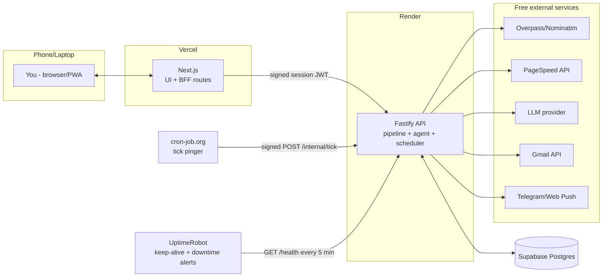

# Outreach Agent (v2): Learning Cold-Email Agent + Mobile-Ready Admin Dashboard

A single-owner, low-volume (≈10 emails/day) agent that finds small businesses, audits their web presence, drafts a specific and honest cold email, lets **you review and edit it**, sends it at a good local time, tracks replies, and **learns from results over time**. Everything is managed from a passwordless, mobile-friendly dashboard. After a business replies, **you** continue the conversation yourself.

> **Status:** Authentication/admin, OSM sourcing/audits, optional exact-name UK Companies House enrichment, reviewed drafting, automatic 24-hour Send Plans, unsubscribe, Gmail reply tracking/SLA alerts, analytics with ROI and KPI breakdowns, a deals board, owner-managed portfolio links, the PWA, notifications, usage metering (PageSpeed calls, self-measured awake hours), the learning agent (bandit, memory, strategist proposals, reset/restore), CI, and backup workflows are implemented. Live sending remains disabled (`DRY_RUN=true`). Still outstanding: registry coverage beyond the UK, a measured real-lead quality check, `shared/` Zod schemas and linting, the licence decision, production deployment, and the pilot.
>
> **What changed from v1:** Python → TypeScript (Node) backend; React/Vite → Next.js; SQLite → Supabase Postgres (database only); local-only → deployed on Vercel + Render; added passwordless allowlist login, admin management, re-contact policy, spam-safety system, learning agent (rewards, instructions, memory), timezone-aware scheduler, notifications, hard reset, PWA/mobile UX, and a long list of extras.

> **What changed in v2.1:** added a **no-website track** (§9.10), data-driven **market selection** limited to major countries (§13A), **Send Plans** announced at least 24 hours before any send (§13B), a **pinned permanent owner** (`alakhsimar8@gmail.com`, no email code; Google Sign-In/passkeys instead, §6), **multi-device Android notifications** that don't depend on which Google account is on each phone (§13C), and an **efficiency budget** for storage, compute, and LLM tokens (§13D).

> **What changed in v2.2:** added the **UptimeRobot keep-alive** on a public `GET /health` route every 5 minutes (§3.1); added a **free-tier verification** section (§3A) checked against current vendor terms (Oct 2026), including two **licence warnings** (Vercel Hobby and UptimeRobot Free are both restricted to non-commercial use) with free drop-in alternatives; liveness route renamed `/healthz` → `/health` everywhere; added a note on free-tier LLM data use (§13D).

---

## Table of Contents

1. [Goals, Constraints, Non-Goals](#1-goals-constraints-non-goals)
2. [Why TypeScript (and an honest note on speed)](#2-why-typescript-and-an-honest-note-on-speed)
3. [Architecture & Free-Tier Reality Check](#3-architecture--free-tier-reality-check)
    - 3.1 [Keep-alive with UptimeRobot (`/health` every 5 min)](#31-keep-alive-with-uptimerobot-health-every-5-min)
3A. [Free-Tier Verification (are all services really free?)](#3a-free-tier-verification-are-all-services-really-free)
4. [Tech Stack](#4-tech-stack)
5. [Monorepo Structure](#5-monorepo-structure)
6. [Authentication & Admin Access](#6-authentication--admin-access)
7. [Data Model](#7-data-model)
8. [Lead Lifecycle](#8-lead-lifecycle)
9. [Pipeline Modules](#9-pipeline-modules)
10. [Contact Policy & Re-contact Decay](#10-contact-policy--re-contact-decay)
11. [Inbox Safety System (staying out of spam)](#11-inbox-safety-system-staying-out-of-spam)
12. [The Learning Agent ("Brain")](#12-the-learning-agent-brain)
13. [Scheduler, Time Zones & Notifications](#13-scheduler-time-zones--notifications)
    - 13A. [Market Selection (major countries only)](#13a-market-selection-data-driven-country-targeting)
    - 13B. [Send Plans (≥ 24 h notice)](#13b-send-plans--24-hours-advance-notice)
    - 13C. [Devices & Notifications (multi-device Android)](#13c-devices--notifications-multi-device-multi-account-android)
    - 13D. [Efficiency Budget (storage, compute, tokens)](#13d-efficiency-budget-storage-compute-llm-tokens)
14. [Backend API](#14-backend-api)
15. [Frontend (Next.js, mobile-first)](#15-frontend-nextjs-mobile-first)
16. [Hard Reset ("Erase Agent Memory")](#16-hard-reset-erase-agent-memory)
17. [Deployment](#17-deployment)
18. [Configuration & Secrets](#18-configuration--secrets)
19. [Compliance](#19-compliance)
20. [Testing Strategy](#20-testing-strategy)
21. [Implementation Phases](#21-implementation-phases)
22. [Risks & Mitigations](#22-risks--mitigations)
23. [Extra Features (creative backlog)](#23-extra-features-creative-backlog)

---

## 1. Goals, Constraints, Non-Goals

### Goals
- Find small businesses in chosen niches/cities with a **visible, fixable web problem** that matches your freelance services.
- Draft short, specific, **fact-backed** emails; you review/edit every email before it goes out (default mode).
- Send ≈10/day total (new + follow-ups + re-contacts), at sensible local times, without landing in spam.
- Never email the same business twice carelessly: strict dedupe plus a **decaying re-contact policy**.
- Track sends, replies, bounces, opt-outs; show rich analytics.
- **Improve over time** from analytics, your rewards/penalties, your instructions, and your edits.
- Use it from your phone (PWA), behind passwordless login restricted to allowlisted emails.
- Reach businesses **with a website and without one** (separate no-website track that finds a public email by legitimate means).
- Target **only major, high-value countries** chosen from data you can see, and **announce every send ≥ 24 hours ahead** (country, local time window, volume).
- Stay **frugal**: minimal storage, minimal LLM tokens, nothing that exhausts free tiers (§13D).

### Constraints
- Cost target: **$0** (free tiers). Known free-tier limits **and licence terms** are handled by design (see §3 and §3A).
- Single owner + a few admins; not multi-tenant.
- Database: **Supabase Postgres only**: no Supabase Auth, Storage, Realtime, or Edge Functions.
- Efficiency budget: steady state under ~100 MB of database, ≈16K LLM tokens/day, and small-instance memory; see §13D.
- Every external service must have a free tier that is both **technically sufficient** and **permitted for this use** (see §3A for the checked list and the two services where the licence needs attention).

### Non-Goals
- No bulk blasting, purchased lists, or scraping personal data.
- No open/click tracking pixels (hurts deliverability and privacy). Reply rate is the primary metric.
- No automated conversations: the agent never answers a human reply.

---

## 2. Why TypeScript (and an honest note on speed)

**Is Python "too slow" for this?** Not in a way that matters here. This system is **I/O-bound**: nearly all wall-clock time is spent waiting on the network (Overpass queries, PageSpeed runs of 10-30 s per site, LLM calls of 2-5 s, Gmail API) and on **deliberate delays** (rate limits, jittered send gaps, ≤10 emails/day). Switching language would not make an email send faster or a PageSpeed run shorter. Python with `asyncio` would finish the same work in about the same time.

**The real reasons TypeScript is the better pick for *this* project:**

| Reason | Why it matters |
|---|---|
| One language, shared types | Zod schemas in `shared/` define each API payload once; frontend and backend can't drift. |
| Next.js ecosystem | The dashboard, PWA, and server-side data fetching are first-class. |
| Simple deploys | Node runs natively on Render; Vercel is built for Next.js. |
| Async-by-default | Node's event loop is a natural fit for a pipeline of network calls. |
| Mature libraries | Fastify, Prisma, Cheerio, Gmail client, web-push, grammY (Telegram), Vercel AI SDK. |

**Where Python would still win:** heavy ML training and notebooks. The agent's learning here is lightweight (Beta posteriors, Thompson sampling, a small logistic regression), which is fine in TypeScript. If you ever need heavy ML, add a small Python microservice rather than rewriting.

**What about Go/Rust?** Faster at CPU work, which this app barely does. Build time would cost far more than any runtime gain. What makes the app *feel* fast is Next.js server rendering, DB indexes, caching, and avoiding cold starts (§3), not the backend language.

**Decision:** Node.js 22 LTS + TypeScript + **Fastify** (fast, mature, schema-driven).

---

## 3. Architecture & Free-Tier Reality Check



**Browser never talks to the backend directly.** Next.js acts as a BFF (backend-for-frontend): the browser only talks to the Vercel origin; Next.js route handlers/server components call the Render API with a short-lived signed service token. This avoids third-party-cookie problems on mobile Safari and keeps the backend URL private.

### Free-tier realities that shape the design (verified against current docs, Oct 2026)

| Platform fact | Consequence in this design |
|---|---|
| **Render blocks outbound SMTP (ports 25/465/587) on free web services** | Do **not** send via SMTP. Use the **Gmail API over HTTPS** (port 443) for sending, reading replies, and login codes. |
| **Render free web services spin down after 15 min without inbound traffic**, then take ~1 min to wake; Render may also restart a free service at any time; local disk is ephemeral | **UptimeRobot pings `/health` every 5 min** to keep the service awake (§3.1). Because Render can still restart the service at any moment, the design **never relies on being awake**: no in-process cron. Use a **tick architecture**: an external pinger calls `POST /internal/tick` every few minutes; the schedule lives in Postgres; any tick runs whatever is due (idempotent, lease-based). Nothing important lives on local disk. |
| **Render free: 750 instance-hours/month per workspace** (a 31-day month is 744 h) | Keeping one service awake 24/7 uses ~744 of the 750 hours. **Run exactly one Render service** (no second web service, no cron service in the same workspace), or the hours run out mid-month and Render suspends all free services until the 1st. |
| **Supabase free: 500 MB DB per project, project pauses after 1 week of inactivity** | Regular ticks count as activity, so the project stays awake. Store compact data (snippets, not full bodies). Add a DB-size monitor (§23). |
| **Vercel Hobby is free but restricted to personal, non-commercial use** | See §3A: a licence decision you need to make before launch. |
| **UptimeRobot Free (50 monitors, 5-min interval) is restricted to personal, non-commercial use** | See §3.1 and §3A: same decision; drop-in free alternatives listed. |
| Free-tier quotas change over time | Keep every external dependency behind an adapter; re-verify limits before launch. |

> **Option:** If cold starts or limits annoy you, Render's cheapest paid web service removes spin-down and the SMTP block, which also makes the keep-alive ping unnecessary. The architecture works either way.

### The tick
- External pinger (e.g. cron-job.org free tier, every 5 min; GitHub Actions as a slower backup) → `POST /internal/tick` with an HMAC-signed timestamp header.
- Backend replies `202` immediately and processes due jobs in the background using a Postgres lease (`SELECT … FOR UPDATE SKIP LOCKED`) so two overlapping ticks never double-send.
- Note: GitHub's free private-repo minutes are limited, so don't use Actions as the *primary* every-few-minutes pinger.

### 3.1 Keep-alive with UptimeRobot (`/health` every 5 min)

**Purpose:** Render's free tier sleeps after 15 minutes with no inbound traffic. A monitor that requests `/health` every 5 minutes means there is always traffic well inside that window, so the service stays warm and the first request of the day doesn't hit a ~1-minute cold start. UptimeRobot also emails you when the API goes down, which is a useful bonus.

**Two different pingers, two different jobs (keep both):**

| Pinger | Endpoint | Auth | Job |
|---|---|---|---|
| **UptimeRobot** | `GET /health` | none (public, read-only) | Keep Render awake + alert you if the API is down |
| **cron-job.org** (backup: GitHub Actions) | `POST /internal/tick` | HMAC-signed header | Run due jobs (prepare, plan, send, pollReplies…) and generate the DB activity that stops Supabase from pausing |

UptimeRobot **cannot** replace the tick: it can't produce the HMAC signature, and `/health` deliberately does no work.

**The `/health` route (public, unauthenticated, safe by design)**
- `GET /health` and `HEAD /health` → `200` with a tiny JSON body: `{"ok":true,"uptimeSec":12345,"version":"<git sha>"}`.
- **No database query, no secrets, no business data.** It must stay cheap (a few hundred bytes) and fast, so a 5-minute ping costs effectively nothing and can't be used to probe the system.
- Listed as the Render **health check path** and exempt from the service-JWT requirement. A generous per-IP rate limit (e.g. 60/min) still applies.
- The deeper checks (DB reachable, last tick age, Gmail connected) live behind auth at `GET /health/inbox` and on the dashboard's Today page, not on the public route.

**UptimeRobot setup**
1. Create a free account → **Add New Monitor** → type **HTTP(s)**.
2. URL: `https://<your-render-service>.onrender.com/health`
3. Monitoring interval: **5 minutes** (the minimum on the free plan).
4. Optional: switch to a **keyword** monitor that expects `"ok":true` in the body.
5. Alert contacts: your email (and optionally the Telegram integration). Alerts after the first failed check are fine; cold starts are avoided precisely because of this monitor.
6. Leave the monitor running permanently; pausing it lets Render sleep within 15 minutes.

> ⚠️ **Licence note (checked Oct 2026):** UptimeRobot's free plan is restricted to personal, non-commercial use in its Terms of Service (this changed in late 2024); commercial use needs a paid plan, starting around $7/month. Because this system supports a freelance business, that restriction may apply to you.
>
> **Free drop-in alternatives that state commercial use is allowed** (identical setup: HTTP monitor on `/health`, 5-minute interval or faster): **StatusCake** (free tier, 5-min checks), **HetrixTools** (free tier, 1-min checks), **Better Stack** (free tier, 3-min checks). Terms change; confirm the commercial-use wording on the vendor's own page before relying on it. Nothing in the code depends on which monitor you choose, only the URL and interval.

**Capacity check:** a 5-minute ping is ~8,900 requests/month. Each response is tiny, so bandwidth and CPU impact are negligible. The real cost is the ~744 instance-hours, which is why only one Render service is allowed (§3).

---

## 3A. Free-Tier Verification (are all services really free?)

*Checked against current vendor documentation and recent pricing guides in October 2026. Free-tier terms change often; re-check before launch and every few months (the Usage page shows the quotas we can measure).*

### Verified now

| Service | Free tier (as checked) | Fits this project? | Watch out for |
|---|---|---|---|
| **Render** (backend) | Free web service, 750 instance-hours/workspace/month, spins down after 15 min idle, no outbound SMTP, may restart any time | ✅ Yes, with one service only | Documented as not meant for general production use; occasional restarts and slow wake-ups are expected, handled by the tick design. Bandwidth and build-minute allowances also apply. |
| **Supabase** (Postgres only) | 500 MB DB per project, 2 free projects, pauses after 1 week of inactivity, unlimited API requests within limits | ✅ Yes | Pause is avoided by ticks; the 500 MB cap is handled by §13D retention/prune. |
| **Vercel** (frontend) | Hobby plan is $0 with generous limits (100 GB transfer, 1M edge requests, single seat) | ⚠️ **Licence** | Hobby is limited to **personal, non-commercial use** by Vercel's terms. A private dashboard that supports a freelance business is plausibly "commercial". See the decision below. |
| **UptimeRobot** (keep-alive) | 50 monitors, 5-minute interval, $0 | ⚠️ **Licence** | Free plan is **personal, non-commercial only**. See §3.1 for free alternatives. |
| **LLM: Gemini API free tier** (default) | Free for Flash-class models, limits per project and per model (requests/min, tokens/min, requests/day), reset daily | ✅ for ~12-20 calls/day | Limits have been cut before and are not guaranteed; on the free tier Google may use inputs/outputs to improve its models. See §13D for what we send. |

### Free as far as we know (not re-verified line by line; confirm at setup)

| Service | Notes |
|---|---|
| Google PageSpeed Insights API | Free with an API key; quota is generous for ≤ 15 audits/day. |
| Google Cloud OAuth + Gmail API + Google Sign-In | Free; consent screen "In production" for a single user (§17). |
| cron-job.org | Free tier; used for `/internal/tick`. |
| GitHub Actions (backup pinger, nightly `pg_dump`) | Free minutes for private repos are limited; backup pinger and nightly dump only. |
| Telegram Bot API | Free. |
| ntfy | Free (public server) or self-hosted; use a private token-protected topic. |
| Web Push (VAPID) | Free; no third-party account needed. |
| OpenStreetMap Overpass + Nominatim | Free under their usage policies (low rate, caching, clear User-Agent). |
| World Bank open data API | Free. |
| Open-source libraries (Fastify, Prisma, Next.js, Tailwind, shadcn/ui, Recharts, Serwist, etc.) | Free. |

### Decision needed: the two non-commercial licences

Both **Vercel Hobby** and **UptimeRobot Free** restrict use to personal, non-commercial projects. This tool exists to win paying clients for your freelance work, so treat it as commercial unless you decide otherwise. Options, all still $0 or near it:

| Piece | Option A (accept the risk) | Option B (stay free and compliant) | Option C (pay) |
|---|---|---|---|
| Frontend host | Keep Vercel Hobby (private, single user, no revenue served from it) | Host the Next.js app on a free tier that allows commercial use, e.g. **Cloudflare** (Workers/Pages via the OpenNext adapter) or **Netlify** free (confirm each one's current terms) | Vercel Pro, $20/seat/month |
| Uptime monitor | Keep UptimeRobot Free | **StatusCake**, **HetrixTools**, or **Better Stack** free tier | UptimeRobot paid, ~$7/month |

**Default in this spec:** build against the generic interfaces so either choice works (the frontend is a standard Next.js app; the monitor only needs a URL). Make the licence decision before go-live, and record it in `docs/decisions/`.

---

## 4. Tech Stack

| Layer | Choice | Notes |
|---|---|---|
| Runtime / language | Node.js 22 + TypeScript (strict) | `tsx` for dev, `tsup`/`tsc` for build |
| Backend framework | **Fastify 5** + `fastify-type-provider-zod` | Schema validation = shared Zod schemas |
| ORM / migrations | **Prisma ORM** + Prisma Migrate | `DATABASE_URL` uses Supabase's transaction pooler; `DIRECT_URL` is for migrations |
| Database | **Supabase Postgres** (DB only) | Use the pooler connection string for the app and a direct/session-pooler URL for migrations |
| Frontend | **Next.js (App Router)** + React + TypeScript | RSC for fast first paint |
| UI | Tailwind CSS + shadcn/ui + Recharts | Mobile-first components |
| Data fetching | TanStack Query (client) + server components (server) | |
| PWA | Serwist (or `next-pwa`) | Installable, offline shell, Web Push |
| Auth | Owner: Google Sign-In (pinned account) + passkeys (`@simplewebauthn/server`); other admins: email OTP | `jose` for JWT/cookies; see §6 |
| Sourcing | OpenStreetMap **Overpass** + Nominatim | Free; cache; respect usage policy |
| Timezone | `tz-lookup` (lat/lon → IANA zone) + `luxon` | Offline, free |
| Holidays | `date-holidays` | Skip local public holidays |
| Website fetch | `undici` + `cheerio`/`linkedom` | **No headless browser** (Render free is small) |
| Site quality | **PageSpeed Insights API** (free key) | Runs Lighthouse remotely; also returns a screenshot |
| Email validation | `node:dns` MX lookup + `email-validator` | No SMTP probing |
| LLM | **Vercel AI SDK** (`ai`) with Gemini free tier default; provider-swappable | Structured output via Zod |
| Email send/read | **Gmail API** (`@googleapis/gmail`), single scope `gmail.modify` | Send + read + labels, no delete |
| MIME building | `nodemailer`'s `MailComposer` (build only, never SMTP) | |
| Notifications | `web-push` (VAPID) + Telegram Bot API + optional ntfy | Device/channel routing and acknowledgements; see §13C |
| Keep-alive / uptime | **UptimeRobot** (or a commercial-friendly free alternative) → `GET /health` every 5 min | Keeps Render awake, alerts on downtime; see §3.1 |
| Tick pinger | cron-job.org (backup: GitHub Actions) → `POST /internal/tick` | HMAC-signed; see §3 |
| Rate limiting | `bottleneck`, `@fastify/rate-limit` | |
| Logging | pino (Fastify default) | |
| Tests | Vitest, `msw`/`undici` MockAgent, Playwright (E2E) | |
| Package manager | pnpm workspaces | |

---

## 5. Monorepo Structure

One repo, separate `frontend/` and `backend/` folders, plus a small shared package.

```
outreach-agent/
├── README.md
├── package.json                      # workspace root scripts
├── pnpm-workspace.yaml               # frontend, backend, shared
├── .github/workflows/
│   ├── ci.yml                        # typecheck, lint, test
│   ├── tick-backup.yml               # slow (e.g. 30 min) backup pinger
│   └── db-backup.yml                 # nightly pg_dump → encrypted artifact
├── shared/                           # @outreach/shared
│   └── src/
│       ├── schemas/                  # zod schemas: lead, email, reply, agent, auth…
│       ├── enums.ts                  # statuses, categories, reward events
│       └── index.ts
├── backend/                          # Fastify API (deploys to Render)
│   ├── src/
│   │   ├── server.ts / app.ts
│   │   ├── config/                   # env + settings loader (zod-validated)
│   │   ├── auth/                     # otp.ts, sessions.ts, serviceJwt.ts, guards.ts, reauth.ts
│   │   ├── modules/                  # HTTP routes + services per domain
│   │   │   ├── leads/ review/ replies/ analytics/ campaigns/
│   │   │   ├── admins/ suppression/ agent/ notifications/ health/ settings/
│   │   │   │                         # health/: public GET|HEAD /health (no DB) + authed /health/inbox
│   │   │   ├── devices/ markets/ plans/ usage/
│   │   ├── pipeline/
│   │   │   ├── sourcing.ts           # Overpass → businesses (site track)
│   │   │   ├── sourcingNoSite.ts     # no-website track (OSM contact tags, registries)
│   │   │   ├── markets.ts            # market scorecard + allowlist enforcement
│   │   │   ├── plans.ts              # Send Plans (≥24 h notice, veto, freeze)
│   │   │   ├── audit.ts              # site checks + PageSpeed
│   │   │   ├── scoring.ts            # opportunity score + findings
│   │   │   ├── contacts.ts           # email discovery + validation
│   │   │   ├── selection.ts          # picks today's leads (policy + agent)
│   │   │   ├── recontact.ts          # decay policy
│   │   │   ├── drafting.ts           # LLM prompt + validators
│   │   │   ├── spamGuard.ts          # pre-send lint + health checks
│   │   │   ├── sender.ts             # Gmail send, caps, jitter, holds
│   │   │   ├── replyTracker.ts       # Gmail history poll + classification
│   │   │   └── followups.ts
│   │   ├── agent/
│   │   │   ├── bandit.ts             # Thompson sampling, shrinkage
│   │   │   ├── rewards.ts            # event → reward mapping, manual feedback
│   │   │   ├── scorer.ts             # logistic model for P(reply)
│   │   │   ├── memory.ts             # instructions, lessons, retrieval
│   │   │   ├── strategist.ts         # weekly LLM analysis → proposals
│   │   │   ├── explain.ts            # "why this lead / why this email"
│   │   │   └── reset.ts              # snapshot + wipe learned state
│   │   ├── scheduler/
│   │   │   ├── tick.ts               # lease, due-job runner
│   │   │   ├── jobs/                 # prepare, send, pollReplies, strategist, digest, housekeeping
│   │   │   ├── windows.ts            # best-time windows per country/tz
│   │   │   └── holidays.ts
│   │   ├── integrations/
│   │   │   ├── gmail/ overpass/ pagespeed/ llm/ telegram/ webpush/
│   │   └── lib/                      # crypto (AES-GCM), tz, text similarity, rate limiter
│   ├── prisma/
│   │   ├── schema.prisma
│   │   └── migrations/
│   └── tests/ (fixtures: .eml samples, HTML pages, Overpass JSON)
├── frontend/                         # Next.js (deploys to Vercel, or Cloudflare/Netlify; see §3A)
│   ├── src/
│   │   ├── app/
│   │   │   ├── (auth)/login/
│   │   │   ├── (app)/                # protected shell
│   │   │   │   ├── today/ review/ leads/[id]/ replies/ pipeline/
│   │   │   │   ├── analytics/ brain/ campaigns/ inbox-health/
│   │   │   │   ├── admin/ settings/ danger/
│   │   │   ├── api/                  # BFF: auth/*, proxy/* (forwards signed session JWT)
│   │   ├── components/ hooks/ lib/
│   ├── public/ (manifest.webmanifest, icons, service worker)
│   └── next.config.ts
└── docs/ (runbook.md, architecture.md, decisions/)
```

---

## 6. Authentication & Admin Access

**Requirement:** passwordless; only emails you list can enter; you can add/remove admin emails from the dashboard.

### Owner account (permanent, no email code)
- The owner is **`alakhsimar8@gmail.com`**. It is pinned in config (`OWNER_EMAIL`), is the **only mailbox the agent sends from**, and is protected three ways: the API refuses to delete/demote/rename it, a database trigger blocks the same, and startup re-creates the row if it is ever missing. Nobody can remove it from the Admin page.
- **No code is ever emailed to the owner.** Sign-in uses **Google Sign-In (OIDC)** for exactly that address (`email_verified = true`, and the Google account `sub` is pinned on first login). On an Android phone already signed into that Google account, it is one tap.
- After the first sign-in on a device, that device gets a **trusted 90-day sliding session** and can register a **passkey** (fingerprint/face/screen lock via WebAuthn). From then on, either the active session or a passkey can be used without an email code or Google prompt.
- **Why not "type the email and you're in"?** An email address is public information. Skipping verification entirely would let anyone who knows it log in as the owner. Google Sign-In, passkeys, and trusted devices give the same "no code to fetch" convenience while still proving it's you.
- Gmail connects through a separate owner-only OAuth flow (`gmail.modify`); the callback verifies Gmail `getProfile` against `OWNER_EMAIL` before accepting it. Its refresh token is encrypted in Postgres with AES-256-GCM. `GMAIL_REFRESH_TOKEN` remains an environment fallback for existing installs.
- Google Sign-In verifies identity independently of the Gmail refresh token, so login does not depend on Gmail availability.

### Admin sign-in (email code, mobile-friendly)
1. User enters email on `/login`.
2. Next.js → backend `POST /auth/otp/request`. Backend checks the **allowlist** (`admin_users`). Response is always the same generic message ("If this email is allowed, a code was sent") so emails can't be probed.
3. If allowed: generate a 6-digit code, store **HMAC(code, pepper)** with 10-minute expiry, single-use; email it via Gmail API.
4. User enters the code → `POST /auth/otp/verify` (max 5 attempts per code, constant-time compare).
5. On success, the backend creates an `auth_sessions` row and returns a signed session JWT; Next.js stores it in an **httpOnly, Secure-in-production, SameSite=Lax** cookie. Owner sessions slide for 90 days; admin sessions slide for 14 days. Each session records a device label.
6. Every proxied request is checked against the live session row and rotates the cookie token. Revoking a session or removing an admin takes effect immediately.

Why OTP instead of magic links: a 6-digit code works across devices and in-app browsers; magic links often open in the wrong browser on phones (especially for an installed PWA).

**Note:** admins whose email is a Google account may also use "Continue with Google". The owner can use a registered passkey after first signing in with Google.

### Roles & admin management
- `owner` (you, **alakhsimar8@gmail.com**, single permanent owner): everything, including admin management, hard reset, Gmail connection.
- `admin`: operate the dashboard (review, edit, analytics, replies); cannot manage admins, reset, or connect/disconnect Gmail.
- The owner is pinned by the `OWNER_EMAIL` env var (re-created at startup if the row is ever missing). Everyone else is an `admin`.
- Dashboard **Admin & security** page: add/remove admin emails, register/remove owner passkeys, see active sessions, revoke sessions, and view the audit log.
- Guardrails: the owner can't be removed, demoted, or renamed (API check + DB trigger); removing an admin revokes all their sessions instantly; access changes are written to `audit_log`.
- **Step-up auth:** implemented owner-only changes (admin management, passkey changes, Gmail connect/disconnect) require a fresh Google identity token issued within five minutes. Passkeys authenticate the owner but are not yet accepted for step-up.

### Security checklist
- Rate limits: OTP requests per email and per IP; generic errors; lockout/backoff.
- Supabase: enable **RLS with no policies** on all tables and keep the Data API/anon key unused, so nothing is reachable except through the backend's server credentials.
- Gmail refresh tokens connected through the dashboard are encrypted at rest with AES-256-GCM; legacy environment fallback tokens remain deployment secrets.
- Session cookies are httpOnly and SameSite=Lax; mutations are sent through the same-origin Next.js BFF. Backend application APIs require a valid signed session JWT; OTP/Google/passkey sign-in entry points are intentionally public and allowlisted, and `/internal/tick` uses its separate secret.
- `/health` returns no data beyond `ok`, uptime, and version; it never touches the database.
- Dependabot/Renovate; `pnpm audit` in CI.

---

## 7. Data Model

Postgres via Prisma. Key tables (abridged, columns that matter for behavior):

```sql
-- Access
admin_users(id, email UNIQUE, role CHECK in ('owner','admin'), added_by, created_at)
auth_otps(id, email, code_hmac, expires_at, attempts, used_at, ip)
auth_sessions(id, admin_id, device_label, created_at, last_seen_at, expires_at, revoked_at)
audit_log(id, actor_email, action, target, meta jsonb, created_at)

-- Targets
businesses(id, osm_id UNIQUE, name, niche, city, country, tz,
           track,                       -- 'site' | 'no_site'
           website_url NULL, domain NULL, social_only bool,
           phone, address, lat, lon, status, chain_flag, created_at)
audits(id, business_id, fetched_at, metrics jsonb, opportunity_score,
       findings jsonb,              -- compact: [{id,v,src}] (labels rendered client-side)
       thumb_webp bytea NULL)       -- <=8 KB, only while the lead is in review; purged after decision
contacts(id, business_id, email, source_url, is_role_address, mx_valid, UNIQUE(business_id,email))

-- Outreach
campaigns(id, name, niche, region, tz, offer_text, active)
sequences(id, business_id, seq_no,                 -- 1 = first outreach, 2+ = re-contacts
          started_at, ended_at, outcome,           -- replied|no_reply|bounced|unsub
          angle_ids text[])                        -- findings/angles used (to vary next time)
emails(id, sequence_id, business_id, contact_id, step,         -- 0 first, 1..2 follow-ups
       subject, body, edit_diff jsonb NULL, plan_id,           -- edit_diff = compact diff vs agent draft (only if edited)
       edited_by_human bool, status,   -- drafted|approved|held|sent|failed|bounced|rejected
       confidence real, spam_score real, variant text,
       scheduled_for, hold_until, sent_at,
       gmail_message_id, gmail_thread_id, rfc_message_id, error)
replies(id, email_id, business_id, received_at, from_addr, snippet,
        category,        -- human|auto_reply|ooo|bounce|unsubscribe|complaint_like
        sentiment,       -- positive|neutral|negative|unknown (rule/LLM, human-overridable)
        handled bool, notes)
deals(id, business_id, stage, value_amount, currency, updated_at)   -- conversation → won/lost

-- Policy (survive resets)
contact_ledger(id, email_hash, domain_hash,        -- SHA-256(pepper+value): dedupe survives data purges
               business_id, first_contacted_at,
               last_contacted_at, sequences_count, last_outcome, blocked_until, permanent_block bool)
suppression(id, email, domain, reason, created_at)          -- NEVER erased by agent reset

-- Agent brain (erased by hard reset)
agent_memory(id, kind,            -- instruction|lesson|guardrail|preference
             scope jsonb,         -- {global}|{niche}|{region}|{variant}
             text, source,        -- user|strategist|edit_diff
             confidence, evidence_count, active bool, expires_at, created_at)
agent_arms(id, dimension,         -- niche_region|variant|hour_band|angle…
           key, alpha real, beta real, n int, updated_at)    -- Beta posteriors
agent_feedback(id, target_type, target_id, score int,        -- -5..+5
               note, created_by, created_at)
agent_proposals(id, kind, summary, rationale, patch jsonb, status, created_at, decided_at)
agent_models(id, kind, version, params jsonb, trained_on int, created_at)
draft_edits(id, email_id, diff jsonb, edit_distance int, created_at)
reset_snapshots(id, created_at, payload jsonb, restore_until)

-- Ops
job_schedule(job, next_run_at, lease_until, lease_owner, last_status)
job_runs(id, job, started_at, finished_at, status, stats jsonb, error)
notification_prefs(admin_id, event, channel, enabled, quiet_hours jsonb)
seed_tests(id, sent_at, provider, placement, notes)
settings(key, value jsonb)

-- Markets, plans, devices, usage (v2.1)
markets(country_code PK, tier, status,           -- enabled|watch|disabled|auto_paused
        score real, components jsonb,            -- prior/data parts + evidence n
        n_sends int, n_replies int, last_scored_at)
send_plans(id, market, tz, window_start_utc, window_end_utc,
           planned_count, announced_at,
           status,                               -- announced|confirmed|vetoed|executing|done|rolled_over
           rationale jsonb, decided_by, decided_at)
devices(id, admin_id, session_id, label, platform,
        push_sub jsonb NULL, telegram_chat_id NULL, ntfy_topic NULL,
        prefs jsonb, last_seen_at, last_push_ok_at, enabled)
llm_usage(day, task, calls, tokens_in, tokens_out)      -- one row per day per task
stats_daily(day, market, niche, track, variant, step,
            sent, delivered, replies, positive, bounces, unsub)   -- rollups; analytics read these
```

Indexes: `businesses(status)`, `businesses(domain)`, `emails(status, scheduled_for)`, `emails(gmail_thread_id)`, `contact_ledger(email_hash)`, `contact_ledger(domain_hash)`, `suppression(email)`, `suppression(domain)`, `replies(business_id)`.

**Design rule:** `contact_ledger` and `suppression` are the system's *compliance memory*. They are intentionally separate from the agent's *learning memory* so a hard reset can never cause re-emailing someone who opted out.

---

## 8. Lead Lifecycle

```
sourced → audited → qualified → email_found → selected → drafted → in_review
   ↓          ↓          ↓            ↓                              │
 (skip)  (no_website) (low_score) (no_email)             approved ─(hold/undo window)→ scheduled → sent
                                                                                          │
                          ┌───────────────────────────────────────────────────────────────┤
                          ↓                         ↓                  ↓                  ↓
                   follow-up 1 → 2              replied            bounced          unsubscribed
                          ↓                         ↓
                    cooldown (re-contact policy)   conversation → call → proposal → won/lost
```

Rules:
- `replied`, `bounced`, `unsubscribed`, `complaint_like` → **never automatically contacted again** (permanent block; replied leads move to the manual deal pipeline).
- A finished sequence with no reply enters `cooldown` governed by §10.

---

## 9. Pipeline Modules

### 9.1 Sourcing
- Geocode city with Nominatim (30-day database cache) → separate Overpass queries for site and no-site candidates; deduplicate on `osm_id`.
- If the primary Overpass instance fails, discovery tries a secondary instance; failures and per-campaign result counts are written to backend logs.
- Derive the business **timezone** from lat/lon (`tz-lookup`).
- Skip known chains, repeated names, likely multi-branch legal entities, directory links, government/NGO, abandoned listings, and listings with stale `check_date` values.
- Fallback: CSV import (up to 50 rows, ISO-2 market codes) and manual "add lead" form; a supplied email must include its public source URL.
- Two tracks: **site** (has a business website; this section) and **no-site** (§9.10). Only businesses in an enabled market are sourced or sent.

### 9.2 Website audit
- Respect `robots.txt`, use a clear User-Agent, enforce timeouts and response-size limits, and reject private/reserved IP targets and unsafe redirects.
- HTML checks (HTTPS, viewport, contact form, booking/ordering signals, copyright year, platform fingerprint) via `cheerio`.
- Cheap checks run first; when they find an opportunity and `PAGESPEED_API_KEY` is configured, call **PageSpeed Insights** (mobile) for performance, SEO, accessibility, and LCP. A returned screenshot is converted to WebP ≤ 8 KB and retained only while the lead is in review (deleted on decision, or after 30 days).
- No headless browser needed.

### 9.3 Scoring & findings
Opportunity score (0-100) from the current rule-based signal weights; each signal yields evidence (e.g., "Mobile PageSpeed 34/100", "Footer shows © 2019", "No booking link found on homepage"). Only verified findings are passed into a draft. Agent-adjusted weights are a later phase.

### 9.4 Contact discovery
- Sources: OSM `email` tag, `mailto:` and regex on homepage + up to three contact/about pages (four pages total).
- Prefer role addresses; record `source_url` for every address.
- Validate syntax + MX. **No SMTP probing.** Exclude known disposable providers and (EU/UK) personal email providers; suppressions are checked by email address.
- For businesses with **no website**, see §9.10 (OSM contact tags, open registries; no guessing, no social-media scraping).

### 9.5 Selection (today's batch)
`selection.ts` builds the daily pool:
1. Capacity = daily cap (warm-up adjusted) − already-sent/scheduled − follow-ups due.
2. Candidate pool = new qualified leads + re-contact-eligible leads (§10).
3. Rank by **expected value** = P(reply) × value weight, with P(reply) from the agent (§12), plus an **exploration share** (default 15%).
4. Apply hard filters (domain lock, health state, per-region limits) and take the top N.
5. Restrict to the market(s) in today's **Send Plan** (§13A/§13B). Only these leads are drafted (just-in-time, §13D).

### 9.6 Drafting
Inputs: business, verified findings, your offer, **portfolio matcher** pick (best-fitting project from your case-study library), agent memory (relevant instructions/lessons), previous angles (for re-contacts: *must use a different angle*), language hint from the site.

Prompt rules: 80-120 words; plain text; one specific verified observation with its number; one sentence of how you'd fix it; one proof link at most; one low-pressure CTA; no hype, no fake familiarity, no invented facts; strict JSON `{subject, body, finding_ids_used[], confidence}` via Zod structured output.

Validators (retry ≤2×, else flag for manual writing): word/length limits, no unverified numbers or claims, allowed-link check, subject rules, banned-phrase list (including phrases from your instructions), near-duplicate check vs. recent emails (§11). Compliance footer is appended **by code**, never by the LLM.

Follow-ups: ≤50 words, same thread, at +4 and +9 days (configurable), only if the sequence is still silent and the account health is green.

### 9.7 Review & edit (your control point)
- Review UI shows: draft (editable subject/body), **agent findings with evidence + source URL**, site thumbnail, score breakdown, "why selected" explanation, recipient + where the address was found, spam-guard result, and the **diff vs. the agent's original** once you edit.
- Actions: Approve, Edit & Approve, Regenerate (optional instruction: "shorter", "mention X"), Reject (with reason chips), **Give feedback** (👍/👎, −5..+5, optional note).
- Edits are saved to `draft_edits` (original vs. final + edit distance) → feeds learning (§12).
- **Undo window:** after approval, an email is `held` for N minutes (default 30) before it enters the send queue. You can pull it back from the Today page or a push notification.
- Approved emails are **slotted by recipient time zone**: you can approve at 8 AM IST; the email goes out inside the recipient's best local window (§13).

### 9.8 Sender (Gmail API)
- Preconditions per email, checked again right before sending: not suppressed, ledger lock OK, spam guard passes, health state green/yellow, inside window, under caps, and **covered by a Send Plan announced ≥ 24 h earlier and not vetoed** (§13B).
- Build MIME (plain text), headers: `List-Unsubscribe` (https one-click endpoint + mailto) and `List-Unsubscribe-Post: List-Unsubscribe=One-Click`; compliance footer.
- Send via Gmail API; store `gmail_message_id`, `gmail_thread_id`, and the RFC `Message-ID`. Follow-ups use the stored `threadId` + `In-Reply-To`/`References`.
- Jitter 4-15 min between sends; at most 1-2 sends per hour per recipient region; failures retried ≤3× with backoff; hard failure → suppress + mark bounced.
- `DRY_RUN` mode renders MIME to the DB/log instead of sending.

### 9.9 Reply tracker
- Each tick: Gmail `history.list` from the stored `historyId` (cheap), fetch new messages in tracked threads.
- Classification (rules first, small LLM call only for ambiguous sentiment, always human-overridable):
  - `bounce` (DSN from mailer-daemon; parse `Final-Recipient`/`Status`) → hard bounce suppresses.
  - `auto_reply`/`ooo` (headers `Auto-Submitted`, `Precedence`, subject patterns) → not a reply; optionally delay follow-up.
  - `unsubscribe` ("remove me", "stop", "unsubscribe") → suppress immediately (email + domain).
  - `complaint_like` ("spam", "report you", "how did you get my email") → suppress + health penalty + alert.
  - `human` → counts as a reply; stops all automation for that business.
- Apply Gmail label `Outreach/Replied` so you can find it in Gmail on your phone; store only a short snippet.
- Dashboard "Open in Gmail" deep link uses the thread id so **you answer from Gmail**.
- **Reply SLA nudges:** if a human reply is unhandled for 12/24 h, send a push/Telegram reminder.

### 9.10 No-website track

Many good prospects (restaurants, salons, clinics, trades) have **no website at all**. They get their own track with a different offer ("get online") and a different way of finding a contact address.

**Sourcing.** Same Overpass flow with an inverted filter: named, operating businesses with a phone or opening hours but **no `website` / `contact:website` / `url` tag**. Skip anything tagged `disused:`/`abandoned:`, with a stale `check_date`, or that looks like a chain. Businesses whose listing links only to Facebook/Instagram are flagged `social_only` (a strong, verifiable finding).

**Findings are phrased honestly.** OSM is incomplete, so the agent never claims "you have no website". Allowed phrasing: *"I couldn't find a website linked from your public listings."* Only verified signals are used: no website tag, listing links only to a social page, phone listed but no online booking/ordering link.

**Finding an email without a website (legitimate sources only):**
1. OSM `email` / `contact:email` tags.
2. Your own CSV / manual entries with a public source URL.

The optional UK Companies House adapter enriches an existing GB lead only when its normalized company name has one unambiguous exact match. It records company-level status/type/incorporation/SIC data; it does **not** find contact emails. No directory scraping or other country registry adapter is enabled. Do not assume a registry lookup occurred unless `COMPANIES_HOUSE_API_KEY` is configured and an exact match is shown in the lead's evidence.

**Explicitly not done:** scraping Facebook/Instagram/Google Maps/WhatsApp, guessing addresses (info@…), buying lists, or emailing personal addresses of sole traders in the EU/UK.

**Honest expectation:** only a minority of no-website businesses publish an email (typically single digits to low teens in percent), so this pool is smaller. The dashboard tracks the **email-found rate** per market and niche, and the market scorecard (§13A) uses it, so effort shifts to where the yield is real.

**No email? Manual call queue.** Leads with a phone number but no email go to a *Call/DM list* with the finding, a short script, and a map link. The agent never automates calls or messaging apps; it only saves you the research.

**Scoring and drafting.** `track = no_site` has its own opportunity score (operating evidence + missing-presence signals) and its own template variants ("starter site + Google Business Profile + booking"). It appears as a separate dimension in the bandit and analytics so you can see which track pays. No PageSpeed call and no screenshot are needed, so it is also the cheaper track for storage and quota.

**Policy:** identical to the site track: ledger, domain/email dedupe, cooldowns, suppression, spam guard, Send Plans.

---

## 10. Contact Policy & Re-contact Decay

**Principle:** if someone didn't reply before, the chance they reply now is lower, but not zero (circumstances change). So re-contacting is allowed *rarely*, *later*, and only with a *fresh angle*.

### Hard rules (never violated)
- Never contact: suppressed emails/domains; anyone who replied (any category), unsubscribed, bounced hard, or looked like a complaint.
- **One contact per domain** at a time (normalize `www.`, subdomains, and obvious chains). A domain lock lasts through the cooldown.
- Dedupe by normalized email, domain, phone, and fuzzy name+address (to catch duplicate OSM entries).
- Max sequences per business (default **3**: initial + up to 2 re-contacts).

### Re-contact eligibility
A business with a finished, silent sequence #k is eligible for sequence k+1 only if **all** hold:
1. `days_since_last_send ≥ min_cooldown[k]` (defaults: **90** days after #1, **180** days after #2).
2. Fresh re-audit still qualifies (score ≥ threshold) and the site is live.
3. Estimated reply probability ≥ `min_p` (default 1%).
4. A **different angle** is available (a finding/offer not used before) or the site changed meaningfully (new problems, new redesign).
5. Re-contacts consume at most **20% of daily capacity** so new leads are never starved.

### Decaying probability model
```
P(k, Δt) = P_seg × γ^(k−1) × (1 − e^(−Δt/τ)) × change_bonus
```
- `P_seg`: posterior mean reply rate of the lead's segment for first contacts (Beta, shrunk toward global).
- `γ` (re-contact penalty, prior 0.4): *learned* from data as the ratio of reply rates for sequence ≥2 vs. sequence 1 (with shrinkage, so it doesn't swing on tiny samples).
- `τ` (time-to-forget, default 60 days): the longer since the last email, the less "annoying" a new one is.
- `change_bonus`: 1.0-1.5 when re-audit shows meaningful change.

Worked example (P_seg = 4%, γ = 0.4, τ = 60):

| Contact | Δt | P | Eligible (min_p = 1%)? |
|---|---|---|---|
| 2nd (k=2) | 90 d | 0.04 × 0.4 × (1−e^−1.5) ≈ **1.24%** | Yes |
| 3rd (k=3) | 180 d | 0.04 × 0.16 × (1−e^−3) ≈ **0.61%** | No, stops naturally |

So the policy self-limits, and if the agent learns re-contacts perform worse than assumed, γ drops and it re-contacts even less. The dashboard shows, per lead, **"Why can/can't we email this business?"** (rule hit, cooldown remaining, P estimate).

---

## 11. Inbox Safety System (staying out of spam)

> No one can *guarantee* inbox placement; filters learn from recipient behavior. The goal is to stack every legitimate safeguard, **measure placement**, and stop automatically when signals turn bad.

### Layer 1: Identity & authentication
- Sending from a real Gmail account (Google handles SPF/DKIM). Use an **aged account with normal activity**, not a brand-new one.
- *Optional upgrade (not free):* a separate outreach domain with SPF/DKIM/DMARC to protect your main address's reputation.
- Real sender name, real postal address in the footer, consistent From/Reply-To.

### Layer 2: Recipient hygiene
MX validation; role/generic address awareness; disposable-domain blocklist; never retry a bounced address; per-domain lock; sole-trader handling in the EU/UK.

### Layer 3: Content guard (`spamGuard.ts`)
**Hard blocks** (email cannot be approved/sent until fixed):
- Spam-trigger phrases ("free", "guarantee", "act now", "limited time", etc. from an editable list) or ALL-CAPS / "!!!" subjects.
- More than **one** link, URL shorteners, attachments, images, HTML formatting (plain text only).
- Over length limits (subject > 60 chars, body > ~140 words).
- **Near-duplicate detection:** shingle/Jaccard similarity ≥ 0.8 against any email sent in the last 30 days, because templated blasts are a spam fingerprint.
- Missing opt-out line/footer; unverified claims.

**Warnings** (shown in review): generic opening, weak personalization (< 1 specific verified fact), low-confidence finding, first email to a new mailbox provider.

### Layer 4: Behavior & throttling
- **Automatic warm-up ramp:** week 1 → 3/day, week 2 → 5, week 3 → 7, then up to 10, and only while health stays green.
- Jittered gaps; weekdays only; recipient-local business hours; per-hour and per-provider soft limits; skip local public holidays.
- Daily cap enforced in the database (not just memory).

### Layer 5: Feedback loops & health score
Rolling 30-send **health traffic light**:
| Signal | Yellow | Red |
|---|---|---|
| Hard bounce rate | > 2% | > 5% |
| Complaint-like replies | any | ≥ 2 |
| Seed-inbox placement (spam/promotions) | any miss | repeated misses |
| Replies | 0 in 100+ sends → "content problem" warning | n/a |

Yellow halves the daily cap and alerts you; **Red auto-pauses sending**, pings you, and requires an owner to resume.

### Layer 6: Placement testing
Weekly **seed tests**: the agent sends a normal-looking test email to your own mailboxes at other providers (and a second Gmail), then checks via the Gmail API (for Gmail seeds) whether it landed in Inbox, Promotions, or Spam. Results appear on the **Inbox Health** page and feed the health score.

### Layer 7: Opt-out excellence
Footer line + `List-Unsubscribe` mailto + one-click https endpoint (`/u/:signedToken`, no login). Honor instantly; suppression is permanent and domain-aware.

---

## 12. The Learning Agent ("Brain")

**Honest expectation:** at ~300 emails/month and a low-single-digit reply rate you'll see roughly 5-15 replies a month. That's very little data. So the agent uses **Bayesian methods with strong shrinkage**, shows uncertainty, and never pretends a segment is "proven" off a few replies. It also learns from richer signals than replies alone: your edits, feedback, and instructions.

### 12.1 What the agent learns
| Component | What it decides | How |
|---|---|---|
| **Allocation bandit** | Which niches/regions get more of tomorrow's capacity | Thompson sampling over `niche × region` Beta posteriors, hierarchical shrinkage toward global rate, min exploration share (15%) |
| **Lead scorer** | P(reply) per lead from its features (score components, platform, has_booking, niche, city size…) | Priors/hand weights first; logistic regression retrained weekly once ≥150 labeled sends exist; stored in `agent_models` |
| **Template/style bandit** | Variant, subject style, CTA type, send-hour band | Thompson sampling; reports P(B > A) with credible intervals |
| **Re-contact penalty γ** | How much to trust a second try | Learned ratio with shrinkage (§10) |
| **Playbook memory** | Wording/behavior rules | Instructions + lessons retrieved into the drafting prompt |
| **Strategist (weekly LLM)** | Proposes strategy changes | Reads analytics + edit diffs + feedback → writes **proposals** for you to accept/reject |

### 12.2 Rewards (automatic)
| Event | Reward |
|---|---|
| Positive human reply | +1.0 |
| Neutral human reply | +0.3 |
| Call booked | +3.0 |
| Deal won | +10 (value-weighted) |
| Negative reply ("not interested") | −0.3 |
| Unsubscribe | −1.0 |
| Hard bounce | −1.0 |
| Complaint-like reply | −5.0 |

Primary bandit signal is a binary "meaningful reply"; the rest weights the value model. Replies arrive late, so outcomes are attributed within a configurable window (default 14 days) and arms are updated incrementally.

### 12.3 Your input (optional, never required)
- **Reward / penalty (−5…+5)** on any email, lead, campaign, niche, or "this week", with an optional note. Applied as *capped pseudo-observations* (max ±3 effective samples) so a single click can't hijack the policy.
- **Instructions** (free text) with scope and optional expiry, e.g. *"For restaurants, don't mention SEO"*, *"Never claim a number we didn't measure"*, *"Prefer shorter subjects"*. Stored in `agent_memory` as `instruction` (highest priority over auto-lessons).
- **Edit learning:** every time you edit a draft, the diff is stored. The strategist summarizes recurring edits ("you often delete the opening compliment", "you shorten CTAs") into **lesson proposals**.
- Dashboard **Brain** page shows the memory list (toggle, edit, delete each item), arm posteriors with credible intervals, the learning curve, pending proposals, and "why was this lead/email chosen?".

### 12.4 Guardrails on learning
- The agent **cannot** change: compliance rules, suppression, daily caps, the spam guard, or auth/admin settings. Those are config-only and owner-controlled.
- Every change is logged; each lesson carries evidence count, confidence, and decays if not reinforced.
- **Freeze learning** toggle and a learning-rate slider.
- Proposals that alter strategy (e.g. shifting allocation >20%) require your approval.
- Autonomy ladder (optional, default L0): **L0** manual approval for all; **L1** agent suggests auto-approve candidates; **L2** auto-approve only high-confidence drafts (edit-rate low, zero spam warnings) *with* the undo window. You can drop back to L0 anytime.

---

## 13. Scheduler, Time Zones & Notifications

### Three clocks
1. **Recipient clock:** when emails should *land* (business-local best windows).
2. **Your clock:** when *you* want to review (default morning in your timezone, with quiet hours).
3. **Notice clock:** every send must be announced to you **≥ 24 hours** ahead via a Send Plan (§13B).

Because approval is **decoupled from sending**, you can review whenever it suits you. Approved emails are scheduled into the next best window for their country/timezone.

### Best-time logic
- Defaults per country: weekday windows (e.g., 09:30-11:30 and 14:00-16:00 local), skip weekends and local public holidays (`date-holidays`).
- The **hour-band bandit** (§12) learns which bands actually produce replies per region, within the allowed windows.
- Never sends outside the window; if the window is missed, it rolls to the next valid one.

### Jobs (all executed by the tick; schedule stored in `job_schedule`)
| Job | When | What |
|---|---|---|
| `prepare` | Daily, ~30 min before your review time | Re-evaluate health, compute capacity, source/audit/qualify as needed, select leads for the next plan, draft emails **just-in-time (only those leads)**, **notify you** |
| `plan` | Every worker tick after drafting; owner can also start one from Settings | Prepares one upcoming plan per enabled market with eligible emails, uses that market's reply history when there is enough evidence, and announces it at least 24 h before the first send (§13B). |
| `send` | Each tick | Send held-expired approved emails whose window is open, respecting caps/jitter |
| `pollReplies` | Every tick (≈5-10 min) | Gmail history poll, classify, update statuses, notify on human replies |
| `reviewReminder` | Evening / next morning | Nudge if drafts are still unreviewed; stale drafts expire after 72 h (findings go stale) |
| `slaReminder` | Every few hours | Unhandled human replies (12/24 h) |
| `seedTest` | Weekly | Inbox placement test |
| `strategist` | Weekly | Analyze, write proposals, send digest |
| `housekeeping` | Nightly | Rollups, cache cleanup, DB-size check, backup health |

### Notifications
See **§13C**: device registry with Web Push on every Android device, Telegram, optional ntfy, escalation, and per-device routing.

---

## 13A. Market Selection (data-driven country targeting)

**Hard rule:** the agent may only target countries on your **enabled-markets allowlist**. Remote or low-value countries are excluded by construction. The agent can *propose* adding or removing a market (with the data behind it) but can never enable one on its own. It may only *pause* a market automatically for safety (bounce/complaint spike).

**Proposed starting allowlist** (you confirm/edit on the Markets page):

| Status | Countries | Notes |
|---|---|---|
| Enabled | United States, Canada, United Kingdom, Australia, United Arab Emirates, Singapore | English-language business environments, high purchasing power, good OSM coverage in major cities. UK follows corporate-address-only rules (§19). |
| Watchlist (off) | Germany, Netherlands, Ireland, New Zealand | Enabled only after you approve; GDPR, language, and market-size considerations. |
| Everything else | Disabled | Never targeted. |

**Market scorecard (0-100)**, visible per country with the reasons and evidence behind each number:

| Component | Prior weight | Source |
|---|---|---|
| Client value (purchasing power, typical project budgets) | 30 | World Bank open data (GDP per capita, PPP), cached monthly + your editable rate table |
| Lead supply (qualified, contactable leads per week) | 20 | Your own sourcing counts |
| Email yield (valid contact found ÷ audited) | 10 | Your own pipeline data |
| Response evidence (shrunk reply rate) | 25 | Your own sends/replies (Beta posterior) |
| Communication fit (time-zone overlap, English share) | 10 | Static table |
| Compliance friction | −5 to −15 | Region rules (§19) |

**Evidence blending:** `score = (1−w)·prior_score + w·data_score`, with `w = n/(n+150)` where `n` is the number of sends in that market. Early on the score is mostly prior (the UI says so: "low evidence, n = 12"); as results arrive, your own data takes over. A market with a great prior but poor results sinks; one with a modest prior but real replies rises.

**Choosing today's market.** Thompson sampling over *enabled* markets only, with a 15% exploration share and at most 2 markets per day (default 1, to keep windows and announcements simple). The agent also drafts a **7-day market calendar** so you can see the plan in advance and override any day.

**Markets page:** current v1 displays component bars, weekly supply/contact yield, enabled state, prior/data blend and GDP PPP. The remaining target UX is listed below.

**Current code status:** the Markets page currently includes the seeded allowlist, owner + step-up enable/disable controls, weighted priors, weekly sourcing counts, email-found rate, and monthly-cached World Bank PPP data. Reply-rate evidence, Thompson sampling, market proposals, sparklines, bounce/complaint trends, and the 7-day calendar are not implemented yet; response stays prior-only and is labeled as untracked in the UI.

---

## 13B. Send Plans (≥ 24 hours advance notice)

**Hard rule:** no email is sent unless a **Send Plan** covering it was announced to you **at least 24 hours earlier**. The plan creator schedules eligible emails at least 24 hours after announcement, and the sender enforces the same 24-hour floor in its database query.

**Current workflow:** the worker prepares plans automatically after drafting, for enabled markets with eligible emails; you can also create one from **Settings → Announced send plans**. The announcement notification links back to that plan; the app lists the businesses, local scheduled times, and review links. Public-holiday avoidance is not implemented yet.

**What a plan tells you**
- **Country/market** and *why now* (top score reasons + evidence count)
- **Local window** (e.g., Tue 09:30-11:30 America/New_York) shown also in **your** time zone and UTC
- **How many emails** (approved / still pending your review), how many are follow-ups or re-contacts, and the track mix (site vs no-site)
- Pacing (gap range), inbox health state, and **Veto / Change / Confirm** buttons

Example notification: `US send plan · 8 businesses · Tue, Nov 10, 9:30 AM EST local time. 6 drafts need review before the planned send.`

**How the timing works**
1. The planner handles each enabled market with eligible emails. It recommends morning or afternoon from historical human-reply outcomes only after at least 40 observations and 15 sends per window; otherwise it uses the weekday morning default.
2. Each email is scheduled in its recipient's timezone and weekday local window. The first scheduled time is at least 24 hours after plan creation; actual holidays are not yet considered.
3. The announcement is delivered immediately and names the market, earliest local send time, number of businesses, and drafts still needing review. It links to the Settings plan list, where business names and review links are shown; personal email addresses are not included in notification text.
4. A reminder arrives ~1 h before sending starts.

**Control and safety**
- **Silence = proceed** (default), but only emails you have approved ever send; unapproved drafts never go out. An optional `requireConfirmation` mode makes a plan wait for your Confirm.
- **Veto** cancels the plan. The automatic planner waits at least 24 h before re-announcing that market; you can use Settings to make a replacement plan sooner.
- **Freeze:** once announced, country and time can be changed only by you. Moving a plan *earlier* is rejected if it would leave < 24 h notice; moving it later is fine.
- Emails not sent by the window's end (not approved in time, cap reached) roll over to the next plan and are never sent outside an announced window.
- Every email carries its `plan_id` for auditing.

---

## 13C. Devices & Notifications (multi-device, multi-account, Android)

**Principle:** notifications attach to **devices**, not to Google accounts. Each phone, tablet, or laptop that signs in to the dashboard registers itself, so it doesn't matter which Google account Chrome or Android is signed into on that device.

**Recommended setup for several Android devices:**
1. **Web Push from the installed PWA on every device** is the backbone. One push subscription per device, free, no Telegram or Firebase account needed, works with the app closed, and uses high-urgency delivery on Android Chrome.
2. **Telegram on your main phone** as the backup for critical alerts. Telegram syncs across every device logged into that Telegram account, and a second Telegram account can also link (multiple chats per admin).
3. **Email digest** (daily/weekly) as a low-priority fallback.
4. *(Optional)* **ntfy** for a device that can't run Chrome push reliably: subscribe it to a private, token-protected topic (works with no Google account). Keep payloads minimal because ntfy sees plaintext.

| Channel | Multi-device | Different accounts per device | Works app-closed | Cost |
|---|---|---|---|---|
| Web Push (PWA) | One subscription per device | Yes (tied to the dashboard session, not Google) | Yes | Free |
| Telegram | Syncs across one Telegram account; link extra accounts | Yes (link each) | Yes | Free |
| ntfy | Any device subscribes to the topic | Yes (no account) | Yes | Free |
| Digest | Primary registered device or channel | Yes | Depends on channel | Free |

**Device and channel registry.** Each push device belongs to its signed-in session; Telegram and ntfy channels belong to the linked admin. The **Devices** page supports push registration, tests, per-event routing, primary selection, mute, quiet hours, and removal. **Notifications** links Telegram using a one-time expiring Telegram deep link and accepts a private HTTPS `ntfy.sh` topic; channel targets are encrypted at rest. Telegram setup requires `TELEGRAM_BOT_TOKEN`, `TELEGRAM_WEBHOOK_SECRET`, and a public HTTPS `BACKEND_PUBLIC_URL`; ntfy is optional. Configure `NOTIFICATION_TIMEZONE`, `NOTIFICATION_DIGEST_TIME`, and `NOTIFICATION_ESCALATION_MINUTES` on the backend.

To enable Web Push, sign in on each device, open **Devices**, enable notifications, and use **Send test**. Generate VAPID keys with `corepack pnpm --filter @outreach/backend exec web-push generate-vapid-keys --json`; set `VAPID_PUBLIC_KEY`, `VAPID_PRIVATE_KEY`, and `VAPID_SUBJECT=mailto:you@example.com` on the backend, then restart it. Keep the private key backend-only. Reply alerts and send-plan reminders use generic text; test notifications are limited to one per device per minute. Logout, session revocation, and admin removal delete that session's registrations.

**Different accounts on different devices.** You (owner) can be signed in on several devices while another admin is signed in on theirs. Routing is per admin and per device, and owner-only events (health red, reset, Gmail problems) go only to the owner's devices.

**Priorities and routing (editable per device/channel)**

| Priority | Events | Delivery |
|---|---|---|
| P0 critical | Send Plan announcement/reminder, reply waiting >4 hours | All enabled devices and channels; escalation after the configured delay; ignores quiet hours (muted destinations remain muted) |
| P1 important | Human reply | All enabled destinations with reply alerts enabled |
| P2 info | Daily/weekly digest | Primary destination only; respects quiet hours |

**Ack-sync, retries, retention.** Acknowledgement in the app or Telegram is shared and sends close-pushes to other registered devices. Delivery is idempotent with at most three attempts per destination; unacknowledged notifications escalate after the configured delay. Notification history is retained for 180 days, Telegram link tokens for 30 days, and hashed seed-placement records for 365 days. Quiet hours use the configured timezone.

The **Notifications** page manages channels and acknowledgement history. The **Usage & inbox health** page shows measured database size, token usage, queue/send counts, last tick, configured warm-up cap, bounce/complaint/reply metrics, and manually recorded seed-placement checks. Recipient addresses for seed checks are hashed. Render instance-hours and PageSpeed usage are not available from this application and are not estimated; check the provider dashboards for those figures. Database-size alerts use `SUPABASE_DB_LIMIT_MB` as a configured threshold, not as an entitlement lookup.

**Android notes.** Install via Chrome ("Install app"), allow notifications, and exclude Chrome from battery optimization if pushes arrive late. Pushes use `Urgency: high` with a TTL so time-sensitive plans aren't delayed. Each device needs one sign-in (Google tap or passkey for you, email code for other admins), after which it stays trusted.

**Privacy.** Web Push payloads are encrypted for the browser. Keep bodies short (market, time, counts) with no business names or email addresses in push text.

---

## 13D. Efficiency Budget (storage, compute, LLM tokens)

**Principles:** (1) code does the work, the LLM does only what code can't; (2) store decisions and aggregates, not raw data; (3) every data class has a retention rule and a budget alarm.

### LLM tokens
**Never uses the LLM (pure code):** sourcing, audits, scoring, contact discovery, selection, spam guard, re-contact decay, bandit/learning math, market scoring, send planning, analytics, notifications, and rule-based reply classification.

**LLM budget (small, fast model by default):**

| Task | When | Approx. tokens per call | Calls/day |
|---|---|---|---|
| Draft email | Only for leads selected for the next plan (capacity + ~20% buffer) | ~700 in / ~120 out | ≤ 12 |
| Regenerate | On demand | same | ≤ 5 |
| Reply sentiment | Only when rules are ambiguous | ~200 in / ~30 out | ≤ 5 |
| Strategist (weekly) | Weekly, aggregated stats only, bigger model allowed | ≤ 4K in / ~800 out | 1/week |

Expected total ≈ **16K tokens/day (≈ 0.5M/month)**, with a hard daily cap (default 30K).

**How tokens stay low**
- **Slot-filled templates:** the email skeleton is fixed; the LLM writes only the 2-3 variable sentences (the observation and the fix), cutting output tokens by more than half.
- Findings are passed as compact IDs and numbers, not prose; no chat history is ever sent.
- Memory retrieval is top-5 lessons (≤ ~150 tokens), with periodic compaction/merging of lessons.
- **Just-in-time drafting:** never draft for the whole qualified pool. Unreviewed drafts expire after 72 h and are not auto-regenerated.
- Angles for re-contacts are chosen by code; the LLM only phrases them.
- Short JSON keys, `max_output_tokens` caps, and stop sequences on every call.
- **Token budget manager** with per-task and daily caps. Degrade ladder: shorter prompt → deterministic template-only draft flagged "template" → pause drafting and notify you. Usage is counted in `llm_usage` (one row per day per task).

**Free-tier LLM caveats (checked Oct 2026)**
- Free-tier limits (requests/min, tokens/min, requests/day) are per project and per model, have been reduced before, and can change without notice. The daily budget above (≤ ~17 calls/day) is far below typical free quotas, and the degrade ladder covers a sudden cut or a `429`.
- On Google's free tier, inputs and outputs may be used to improve its models and reviewed by humans. **Therefore the LLM only ever receives business facts and compact findings** (already public information) and **never** reply bodies, email addresses, your instructions' private notes, or anything about clients. Reply sentiment stays **rules-only** while on a free LLM tier; the ambiguous-case LLM call is enabled only on a paid tier or a provider whose terms exclude training on your data.
- The provider sits behind the `integrations/llm` adapter, so switching to another free or paid provider is a config change.

### Storage (Supabase free: 500 MB)

| Data | What is kept | Retention |
|---|---|---|
| Businesses (sourced/skipped) | Slim row (~300 B) | Unqualified/rejected rows purged after 60 days; dedupe continues via hashed ledger |
| Audits | Extracted metrics + compact findings (≤ ~1.5 KB); **no raw HTML or PageSpeed JSON** | Never-contacted: 60 days; contacted: 12 months, then compacted to key fields |
| Thumbnails | Tiny WebP ≤ 8 KB | Only while the lead is in review |
| Emails | Subject + body (~1.2 KB), `edit_diff` only if edited | 24 months |
| Replies | 300-character snippet | 24 months |
| Contact ledger | Salted hashes (32 B each) | Forever (compliance, tiny) |
| Suppression | Email/domain + reason | Forever |
| `stats_daily` | One rollup row per day/market/niche/track/variant/step | Forever (analytics read this, not raw rows) |
| `job_runs` / `audit_log` / OTPs & sessions / `llm_usage` | Operational | 30 d / 180 d / purge expired daily / 90 d |

Projection: roughly 1,500 audited leads/month (~1.5 MB) + 300 emails (~0.5 MB) + small tables, which is under ~5 MB/month raw and a steady state of about **50-100 MB** after retention.

**Guard rails:** the nightly `housekeeping` job reads `pg_database_size`. At 60% it warns you, at 80% it auto-prunes oldest/lowest-value data first, and at 90% it pauses sourcing. It never prunes ledger, suppression, deals, or human replies.

### Compute and bandwidth
- Render free instances are small: stream and cap page downloads (default 1.5 MB), concurrency ≤ 3, small batches, no headless browser.
- **Staged audit funnel:** cheap HTTP/HTML checks first; the PageSpeed API only for sites that pass them (saves quota and time). The no-site track needs no PageSpeed call at all.
- No raw Overpass/PageSpeed responses in the DB; only in-memory LRU caches (disk is ephemeral on Render).
- Dashboards read rollups and paginated queries, never `SELECT *` on JSONB; partial indexes (e.g., on approved/held emails) keep queries cheap.
- `/health` does no database work and returns a few hundred bytes, so the 5-minute keep-alive adds negligible load (§3.1).
- The **Usage & inbox health** page reports values the application can measure and labels unavailable Render instance-hours explicitly. It warns when database size reaches 80% of `SUPABASE_DB_LIMIT_MB`; notification history, expired link tokens, and old seed-placement records are pruned on a daily tick.

---

## 14. Backend API

Base: `https://<render-service>` (authenticated application routes require a signed session JWT; `/health` is public and `/internal/tick` uses its separate secret).

**Auth & admin**
`POST /auth/otp/request` · `POST /auth/otp/verify` · `POST /auth/google` · `POST /auth/passkeys/authenticate/options|verify` · `POST /auth/passkeys/register/options|verify` · `POST /auth/logout` · `POST /auth/reauth`
`GET /auth/me` · `GET /auth/passkeys` · `DELETE /auth/passkeys/:id` · `POST /auth/gmail/connect-url|callback|status|disconnect` · `GET/POST /admins` · `DELETE /admins/:id` · `GET /sessions` · `DELETE /sessions/:id` · `GET /audit-log`

**Pipeline**
`GET /today` (capacity, queue counts, alerts) · `GET /leads` · `GET /leads/:id` (audit, findings, thumbnail, thread, policy explanation) · `PATCH /leads/:id` (notes, tags, snooze, block)
`GET /review` · `PATCH /review/:emailId` (edit) · `POST /review/:emailId/approve|reject|regenerate|hold|unhold` · `POST /review/approve-batch`
`GET /replies` · `PATCH /replies/:id` (handled, sentiment override, notes)
`GET/POST/PATCH /campaigns` · `GET/POST/DELETE /suppression` · `GET/PATCH /deals`

**Analytics**
`GET /analytics/overview|funnel|timeseries|breakdown|latency|deliverability|cohorts|roi`

**Agent**
`GET /agent/overview` · `GET/POST/PATCH/DELETE /agent/memory` · `POST /agent/feedback` · `GET /agent/arms` · `GET /agent/proposals` · `POST /agent/proposals/:id/accept|reject` · `GET /agent/explain/:leadId` · `POST /agent/learning/freeze|unfreeze` · `POST /agent/reset` (owner + step-up) · `POST /agent/reset/restore`

**Markets & plans**
`GET /markets` · `PATCH /markets/:cc` (enable/disable) · `GET /markets/calendar` · `GET /plans` · `GET /plans/:id` · `POST /plans/:id/confirm|veto|reschedule`

**Devices & notifications**
`GET /devices` · `POST /devices/register` (push subscription / Telegram link / ntfy) · `PATCH /devices/:id` (label, prefs, quiet hours) · `POST /devices/:id/test` · `DELETE /devices/:id` · `POST /notifications/ack/:tag`

**Usage & efficiency**
`GET /usage` (DB size, LLM tokens today/month, PageSpeed calls, Render hours) · `PATCH /usage/budgets`

**Ops**
`GET /health` (**public liveness**, also `HEAD`; no DB, no auth; UptimeRobot target, §3.1) · `GET /health/inbox` (authed: inbox health, DB reachable, last tick age, Gmail status) · `POST /sending/pause|resume` · `GET/PATCH /settings` · `POST /integrations/gmail/connect|disconnect` · `GET /jobs` · `POST /jobs/:name/run` · `POST /internal/tick` · `GET /u/:token` (one-click unsubscribe)

---

## 15. Frontend (Next.js, mobile-first)

Next.js App Router, TypeScript, Tailwind, shadcn/ui, Recharts, TanStack Query. Server components fetch through the BFF; client components handle interactivity. **Designed phone-first**, scaling up to desktop. Installable PWA with a service worker for the app shell and Web Push.

### Pages
1. **Login:** the owner taps **Continue with Google** (or uses a passkey); admins enter email → 6-digit code (auto-focus, paste support, resend timer).
2. **Today (home):** capacity ring (sent/cap), drafts awaiting review, held emails with *Undo*, replies needing you, health traffic light, big **Pause sending** switch, the next **Send Plan** (country, local window, your-time equivalent, countdown, Veto/Change), next scheduled sends with recipient local times, and a "last tick / last keep-alive ping" indicator.
3. **Review:** swipeable cards (right = approve, left = reject, tap = edit). Shows the editable draft, findings + evidence + source link, site thumbnail, score breakdown, spam-guard result, "why selected", edit diff, feedback buttons, regenerate with instruction. Batch approve for confident drafts.
4. **Leads:** search/filter table (status, niche, region, score, step). **Lead detail:** audit metrics, findings, thumbnail, timeline of emails/replies, contact sources, **policy panel** ("can we email again? cooldown, P estimate"), notes/tags/snooze, deal stage, Open-in-Gmail.
5. **Replies:** feed with category/sentiment badges, SLA timers, mark handled, set deal stage, Open-in-Gmail.
6. **Pipeline:** Kanban (Replied → Conversation → Call → Proposal → Won/Lost) with deal values.
7. **Analytics:** (details below).
8. **Brain:** memory list (add instruction, toggle, edit, delete), proposals inbox, arm posteriors with intervals, learning curve, freeze switch, reward/penalty history, explain panel.
9. **Campaigns:** niches/regions, offer text, variants, per-campaign stats.
10. **Inbox Health:** traffic light, warm-up stage, bounce/complaint trends, seed-test results, spam-guard blocks log.
11. **Admin:** admin emails (add/remove/role), active sessions/devices, audit log.
12. **Settings:** daily cap, windows, follow-up delays, cooldown/decay parameters, notification channels + quiet hours, Gmail connection, integration status, portfolio/case-study library.
13. **Markets:** scorecard per country (components, evidence `n`, trend), enable/disable, 7-day market calendar, proposals.
14. **Send Plans:** upcoming/past plans, confirm/veto/reschedule, and a history of what was announced vs. actually sent.
15. **Devices:** every signed-in device (e.g., "Pixel · personal"), push/Telegram/ntfy status, per-device event routing + quiet hours, test button, remove.
16. **Usage:** DB size gauge, LLM tokens today/month vs budget, PageSpeed calls, ticks, Render instance-hours this month, retention/prune log, adjustable budgets.
17. **Call queue:** no-email leads with phone, finding, short script, and map link.
18. **Danger zone:** hard reset (see §16).

### Analytics (what you'll see)
- **KPIs:** sent today/cap, sent 7d/30d, delivered (sent − bounced), bounce rate, reply rate, positive-reply rate, calls booked, won, **revenue**, cost per reply (time-based), revenue per 100 emails.
- **Funnel:** sourced → audited → qualified → email found → drafted → approved → sent → replied → positive → call → won (with step conversion).
- **Time series:** sends/replies/bounces per day with 7-day average; cap utilization.
- **Breakdowns (with sample size `n` and credible intervals):** by niche, region/country, template variant, subject style, follow-up step, sequence number (1st vs re-contact), send hour/weekday, finding type used, opportunity-score bucket, portfolio piece cited.
- **Reply latency histogram** and **time-of-day heatmap** per timezone.
- **Draft quality:** approval rate, edit rate, average edit distance over time (proxy for how good the agent is getting).
- **Agent impact:** reply rate of exploit vs. explore sends; allocation shifts over time.
- **Deliverability:** health score history, seed placement, blocks by the spam guard.
- Small-sample honesty: segments with n < 30 labeled "insufficient data".

### Mobile & PWA details
Bottom tab bar (Today, Review, Replies, Analytics, More); large touch targets; pull-to-refresh; offline shell; installable manifest; Web Push permission flow with Android Chrome install guidance; haptic-friendly swipe actions; dark mode.

---

## 16. Hard Reset ("Erase Agent Memory")

Two clearly separate actions in **Danger zone** (owner only):

**A. Reset agent brain (default hard reset)**
Erases *learned state*: `agent_memory`, `agent_arms`, `agent_feedback`, `agent_proposals`, `agent_models`, `draft_edits`, learned parameters (γ, weights, market evidence). The agent returns to its initial priors and default config.

**Always preserved (never wiped by any reset):** `suppression`, `contact_ledger`, sent emails and replies, deals, admins, settings, and the enabled-markets allowlist. These protect compliance and prevent re-emailing people.

**Safeguards**
- Owner only + **step-up check (fresh Google re-auth or passkey)** + type `RESET` + a summary showing exactly what will be erased and counts.
- **Automatic snapshot** before wiping, kept for **7 days** (`reset_snapshots`) with a **Restore** button.
- Learning is frozen during the operation; everything is audit-logged.
- Optional "Reset and keep my instructions" toggle so your hand-written instructions survive.

**B. Factory reset of outreach data** (optional, off by default in the UI): clears businesses/audits/drafts but **still keeps** `suppression` and `contact_ledger`. Requires the same safeguards plus a 24-hour delayed execution (cancelable).

---

## 17. Deployment

| Piece | Platform | Settings |
|---|---|---|
| Frontend | **Vercel** (Hobby) or a commercial-friendly free host (§3A) | Project root `frontend/`; env: `BACKEND_URL`, `SERVICE_JWT_SECRET`, `SESSION_SECRET`; enable access to workspace source outside root if `shared/` is used |
| Backend | **Render** (Web Service, Node 22, **the only service in the workspace**) | Root `backend/`; build `pnpm install --frozen-lockfile --filter @outreach/backend... && pnpm --filter @outreach/backend build`; start `node dist/server.js`; health check path `/health` |
| Database | **Supabase** (Postgres only) | `DATABASE_URL`: transaction pooler for the app; `DIRECT_URL`: direct/session-pooler for Prisma migrations; enable RLS deny-all |
| Keep-alive / uptime | **UptimeRobot** (or StatusCake / HetrixTools / Better Stack, see §3.1) | HTTP(s) monitor on `https://<render-service>/health`, **every 5 min**, email alert on failure |
| Ticker | cron-job.org (free) every 5 min → `/internal/tick` | HMAC-signed request; GitHub Actions slow backup every ~30 min |
| Backups | GitHub Actions nightly `pg_dump` → encrypted artifact (14-day retention) | Free tier of Supabase offers limited backup features, so own it |

Steps:
1. Create Supabase project → in **Connect → ORM → Prisma**, copy the transaction-pooler URL to `DATABASE_URL`; use the direct or session-pooler URL for `DIRECT_URL`.
2. Create Google Cloud project → OAuth client → set consent screen to **In production** (single user, unverified-app warning is fine) so refresh tokens don't expire in 7 days; scope `gmail.modify`. Add the separate sign-in flow (`openid email profile`) in the same project for the owner's Google Sign-In.
3. Get PageSpeed API key, LLM API key, VAPID keys, Telegram bot token.
4. Deploy backend on Render with env vars → run migrations → set `OWNER_EMAIL=alakhsimar8@gmail.com`. Confirm `GET /health` returns `200` in a browser.
5. Deploy frontend on Vercel (or your chosen host); set `BACKEND_URL`.
6. Connect Gmail from the dashboard (owner; the backend refuses any mailbox other than `OWNER_EMAIL`), verify with a **dry-run** → then seed test.
7. Configure the **tick pinger** (cron-job.org → `POST /internal/tick`); confirm ticks in the Jobs panel.
8. Configure the **keep-alive monitor** (UptimeRobot → `GET /health`, 5 min); confirm it shows "Up" and that the Render service no longer sleeps (check the Render logs after 30 minutes of no manual traffic).
9. Make the licence decision from §3A (Vercel Hobby / UptimeRobot Free vs. commercial-friendly free alternatives) and note it in `docs/decisions/`.
10. On **each Android device**: sign in (Google tap or passkey for you), install the PWA from Chrome, allow notifications, name the device, and press **Test**. Optionally link Telegram.

---

## 18. Configuration & Secrets

DB-backed `settings` (editable in the UI) with defaults from `config.default.ts`:
```ts
export const defaults = {
  sender: { name: "Your Name", replyTo: "alakhsimar8@gmail.com", postalAddress: "…", portfolioUrl: "…" },
  limits: {
    maxPerDay: 10, warmup: [3, 5, 7, 10],           // weekly ramp
    sendDays: ["mon","tue","wed","thu","fri"],
    windowsLocal: [["09:30","11:30"], ["14:00","16:00"]],
    gapMinutes: [4, 15], holdMinutes: 30,
    followupDelaysDays: [4, 9], maxFollowups: 2,
  },
  recontact: { cooldownDays: [90, 180], maxSequences: 3, minP: 0.01, tauDays: 60,
               gammaPrior: 0.4, maxShareOfDaily: 0.2 },
  agent: { explorationShare: 0.15, attributionWindowDays: 14, learningFrozen: false,
           autonomy: "L0", feedbackPseudoCap: 3 },
  health: { yellowBounce: 0.02, redBounce: 0.05 },
  qualification: { minOpportunityScore: 40 },
  notifications: { reviewTimeLocal: "08:30", quietHours: ["22:00","07:00"] },
  plans: { leadHours: 24, minLeadHours: 24, reminderMinutesBefore: 60 },
  markets: { enabled: ["US","CA","GB","AU","AE","SG"], watchlist: ["DE","NL","IE","NZ"],
             priorWeights: { value: 30, supply: 20, emailYield: 10, response: 25, commFit: 10 }, evidenceN0: 150 },
  efficiency: { llmDailyTokenBudget: 30000, draftBufferShare: 0.2, dbWarnPct: 60, dbPrunePct: 80,
                maxPageBytes: 1_500_000, auditConcurrency: 3,
                llmSendReplyTextToProvider: false },   // keep false on free LLM tiers (§13D)
  keepAlive: { healthPath: "/health", expectedPingEveryMinutes: 5,
               staleAfterMinutes: 20 },                // Today page warns if no ping seen for this long
  devices: { escalateAfterMinutes: 15, p0Channels: ["push","telegram"], pushUrgency: "high" },
  caseStudies: [ /* { title, url, tags: ["e-commerce"], blurb } — used by the portfolio matcher */ ],
};
```

Env secrets (Render/Vercel; never committed):
```
DATABASE_URL, DIRECT_URL, SESSION_SECRET, OTP_PEPPER, TICK_SECRET,
OWNER_EMAIL, OWNER_GOOGLE_SUB (optional pin), APP_ORIGIN, WEBAUTHN_RP_ID, GMAIL_TOKEN_ENCRYPTION_KEY,
GOOGLE_CLIENT_ID, GOOGLE_CLIENT_SECRET, GMAIL_REFRESH_TOKEN (legacy fallback),
PAGESPEED_API_KEY, LLM_BASE_URL, LLM_API_KEY, LLM_MODEL, LLM_DAILY_TOKEN_BUDGET,
RECONTACT_COOLDOWN_DAYS, SEND_HOLD_MINUTES, PORTFOLIO_PROJECTS, COMPANIES_HOUSE_API_KEY,
VAPID_PUBLIC_KEY, VAPID_PRIVATE_KEY, TELEGRAM_BOT_TOKEN, NTFY_BASE_URL/NTFY_TOKEN (optional), DRY_RUN=true
```
`SESSION_SECRET` and `OTP_PEPPER` must each be at least 32 random characters and must be different. `APP_ORIGIN` is the frontend origin used for WebAuthn and the Gmail OAuth callback; register `${APP_ORIGIN}/api/gmail/callback` as an authorized redirect URI in Google Cloud. `WEBAUTHN_RP_ID` is the frontend hostname (for local development, `http://localhost:3000` and `localhost`). Generate `GMAIL_TOKEN_ENCRYPTION_KEY` as a base64-encoded random 32-byte key. The Gmail connection requires the Gmail API enabled and the `gmail.modify` OAuth scope; the connected mailbox must match `OWNER_EMAIL`. Reauthorize the Gmail connection if its existing grant predates reply reading and labeling. Gmail access is used for campaign sends and admin sign-in codes.
To enable optional UK company enrichment, register an application in the [Companies House Developer Hub](https://developer.company-information.service.gov.uk/), then set its API key as backend-only `COMPANIES_HOUSE_API_KEY`. The adapter makes an exact normalized-name match for GB businesses, records only the company number/status/type/incorporation date/SIC codes and public company-record URL, and does not collect officers' personal data or contact emails. Companies House permits up to 600 requests per five minutes; the adapter does not retry or bypass a `429`. With no key configured it makes no registry requests. This is enrichment of OSM leads, not a complete UK lead-discovery source.
`LLM_BASE_URL` defaults to `https://api.openai.com/v1`; `LLM_MODEL` should be a low-cost model that supports OpenAI-compatible chat completions and JSON mode. The persisted UTC-day budget defaults to 30,000 tokens. Without `LLM_API_KEY`, draft suggestions use templates and are explicitly flagged for manual writing. `PORTFOLIO_PROJECTS` remains an optional JSON source for niche-aware draft matching. Configure the portfolio URL and up to five latest-work links from the owner-only Settings page; these HTTPS URLs are appended to every outgoing message at send time, including follow-ups and already-approved drafts. `PAGESPEED_API_KEY` is optional; without it the pipeline uses only local HTML checks and does not request PageSpeed data or screenshots. Apply Prisma migrations before starting the backend against Supabase; the migrations add auth, markets, contact policy, token accounting, and draft-review fields. The initial enabled market list is US, CA, GB, AU, AE, and SG; DE, NL, IE, and NZ start disabled. Changing market state or refreshing World Bank data requires owner step-up verification.
Web Push is opt-in per browser. Generate a VAPID pair with `corepack pnpm --filter @outreach/backend exec web-push generate-vapid-keys --json` and set all three `VAPID_*` values in the backend environment; never expose the private key to the frontend. Apply Prisma migrations before starting the backend against Supabase; the migrations include the session-bound `push_devices` registry.
The UptimeRobot (or alternative) account needs **no secret in the app**: `/health` is public and read-only. Last-ping tracking uses the request's User-Agent/IP only to show "last keep-alive seen" on the Today page; it stores a single timestamp, nothing else.

---

## 19. Compliance

*(Not legal advice. Verify rules for the countries you target.)*
- Truthful identity, subject, and content; real postal address; clear opt-out in every email; instant, permanent opt-out handling (email + domain).
- **US (CAN-SPAM):** B2B allowed with accurate headers, address, working opt-out.
- **EU/UK (GDPR/PECR):** corporate role addresses are easier; **sole traders are often treated as individuals**: avoid, or require a lawful basis.
- **India (DPDP Act):** minimize data, use publicly listed business contacts, record the source, honor erasure/opt-out.
- Data minimization: store snippets, not full bodies; record `source_url` for each address; retention policy (e.g., purge non-replied lead data after 12 months while keeping the ledger/suppression hashes).
- Scraping etiquette: obey robots.txt, low rate, clear User-Agent, cache; don't scrape Google Maps or sites that forbid automation.
- Google's Gmail policies and your account's terms apply; keep volume low and content genuine.
- **Service terms:** use each platform within its licence (Vercel Hobby and UptimeRobot Free are non-commercial; see §3A) and within the usage policies of Overpass/Nominatim.

---

## 20. Testing Strategy

- **Unit:** Overpass parsing, tz derivation, MX validation (mocked DNS), scoring, draft validators, spam-guard rules, similarity detection, decay formula, bandit math (seeded RNG), reward mapping, OTP generation/verification, signed session JWT, window/holiday calculations.
- **Fixtures:** `.eml` corpus (reply, quoted reply, OOO, DSN bounce, unsubscribe, complaint-like, non-English) → classification + thread matching.
- **Policy tests:** table-driven tests for dedupe, domain lock, cooldown, max sequences, "replied never again", suppression survives reset.
- **Auth tests:** non-allowlisted emails get the generic response and no code; expired/used/over-attempted codes fail; removing an admin invalidates sessions immediately; last-owner protection; step-up required for sensitive actions.
- **Health route tests:** `GET`/`HEAD /health` return `200` without a token, never query the database (assert zero DB calls), and expose no data beyond `ok`, uptime, and version; all other routes still reject unauthenticated requests.
- **Integration (DRY_RUN):** full `prepare → review/edit → approve → hold → send → reply poll` against mocked Gmail/PageSpeed/LLM.
- **Tick safety:** concurrent ticks never double-send (lease test); idempotent job re-runs.
- **LLM eval set:** ~30 businesses with findings; assert no unverified facts, validator pass rate, and diversity (no near-duplicates); assert that no reply text or email address ever appears in a free-tier LLM request.
- **Reset test:** snapshot → wipe → restore round-trip; verify compliance tables untouched.
- **E2E (Playwright):** login via test OTP hook, review/edit/approve on a mobile viewport, undo within hold window, add/remove admin.
- **Live smoke:** send to your own secondary mailboxes; verify reply detection, label, bounce handling, unsubscribe link, seed placement.

---

## 21. Implementation Phases

**Phase 0: Foundations (1 day)**
- [x] Monorepo (pnpm workspaces), TS configs, CI (`.github/workflows/ci.yml`: backend build + tests, frontend typecheck + build). A lint/format setup is not configured yet.
- [ ] `shared/` Zod schemas; Fastify + Next.js skeletons; env validation. Fastify and Next.js are in place, and `preflight` validates the env. There is no `shared/` package yet: request bodies are validated by hand in each route.
- [x] Public `GET|HEAD /health` route (no DB) from day one, so the keep-alive can be wired up at first deploy
- [x] Supabase project, Prisma schema/migrations, RLS deny-all

**Phase 1: Auth & admins (2 days)**
- [x] OTP request/verify, sessions, signed session JWT, BFF proxy
- [x] Owner Google Sign-In (pinned `sub`), passkeys, trusted-device sessions; owner protection (API + DB trigger)
- [x] Allowlist, roles, admin management page, audit log, step-up auth
- [x] Gmail OAuth connect locked to `OWNER_EMAIL` (also sends OTP mail for other admins)
- **Done when:** only allowlisted emails can log in on desktop and phone; the owner signs in with one tap/passkey and cannot be removed; removing an admin kills their session.

**Phase 2: Sourcing, audit, scoring (2-3 days)**
- [x] Overpass + Nominatim + tz lookup; chain/size filters
- [x] Site audit (staged: cheap checks → PageSpeed) + short-lived thumbnail; findings with evidence
- [ ] **No-website track:** inverted Overpass query, honest findings, OSM-email + registry adapters, call queue. OSM contacts, CSV/manual input, honest findings, and the manual call queue are implemented. Optional UK Companies House exact-name enrichment is available when configured; it does not source contact emails. Other country adapters remain gated by the access and data-use terms listed in §9.10.
- [x] Market allowlist + scorecard v1 (priors + World Bank data)
- [x] Lead list + lead detail UI
- **Done when:** 50 real leads in one niche/city show sensible findings. Database migrations are applied; the 50-lead sourcing and quality check is still outstanding.

**Phase 3: Contacts, policy, drafting, spam guard (3 days)**
- [x] Email discovery + syntax/MX validation; suppression checks, contact ledger, domain locks, configurable re-contact cooldown
- [x] Re-contact candidate selection with cooldown eligibility, score decay by prior contacts, distinct angle rotation, and a small exploration share
- [x] LLM drafting with strict JSON shape checks, finding-ID validation, verified-number/link/length/subject/phrase/near-duplicate guards, and up to two retries
- [x] Optional portfolio matching from `PORTFOLIO_PROJECTS`; failed, unavailable, or over-budget LLM drafts are explicitly marked for manual writing and cannot be approved unchanged
- [x] Owner-managed portfolio and recent-work links; every send appends the configured HTTPS links automatically
- [x] Just-in-time drafting with a persisted daily token budget; template drafts when the budget is exhausted
- **Done when:** 10 drafts/day pass the guard and ≥7/10 need no edits.

**Phase 4: Review, send, undo (2-3 days)**
- [x] Review UI (responsive editor, source/evidence panel, edit diff, manual-writing flag)
- [x] Gmail sender: caps, local weekday windows, jitter, hold/undo, HTTPS one-click unsubscribe with opaque, hash-stored tokens
- [x] **Send Plans:** owner creates announced batches ≥24 h ahead; veto/freeze/reschedule controls, audit log and send-time plan state guard
- [x] Automatic Send Plan preparation/notification for enabled markets with eligible emails; one upcoming plan per market at a time
- [ ] `DRY_RUN` end-to-end verification and live self-tests (no live messages have been sent)
- Current sender remains controlled by `DRY_RUN=true` until a human explicitly enables it after reviewing configuration. One-click unsubscribe links use random opaque tokens stored as hashes; send-plan operations require owner step-up.
- **Done when:** end-to-end dry run works; 3 live test emails land in Inbox.

**Phase 5: Replies & follow-ups (2 days)**
- [x] Gmail history poller and rules-first classification; suppress unsubscribe, complaint, and hard bounce; stop automation on human reply
- [x] Gmail reply label, owner-facing reply inbox, four-hour human-reply SLA indicator, and handled-state audit
- [x] Follow-up scheduler creates reviewed, same-thread drafts at +4 and +9 days when the sequence is silent; automatic sends remain subject to the send plan and safety checks
- [x] Four-hour human-reply SLA notification and configurable escalation
- **Done when:** reply classification tests pass; live reply detection still requires a connected Gmail account and an end-to-end verification.

**Phase 6: Analytics, PWA, notifications (3-4 days)**
- [x] Core analytics endpoints/page (sends, Gmail-classified replies/bounces/complaints, activity series, funnel snapshot, won value by currency, small-sample warning)
- [x] Human replies open deals in an editable six-stage pipeline board
- [x] Installable PWA manifest, icon, service-worker registration, and network-only navigation with an offline fallback (private pages/API data are not cached)
- [x] ROI/cost tracking (owner-configured fixed and LLM token costs against won deal value) and KPI breakdowns by niche, country, track, subject style, angle, local send window, weekday and sequence step
- [x] Session-bound device registry and opt-in Web Push, with test notifications and generic human-reply alerts
- [x] Telegram linking, optional ntfy, per-device/channel routing, cross-device ack-sync, bounded delivery retries, escalation, and daily/weekly digests
- [x] Usage & inbox health page, measured database/token/queue metrics, retention/prune jobs, and configured DB-size warning
- [x] Inbox-health rates, manual seed-placement log, and configurable warm-up ramp
- [x] PageSpeed call metering (today against the 25,000/day quota, and the month) and self-measured backend awake hours against the 750 h/month free allowance. Awake time is measured by the process, not read from Render billing, which has no free-tier API.
- **Done when:** every KPI in §15 renders from real data; phone push works.

**Phase 7: Learning agent (3-4 days)**
- [x] Rewards, arms, Thompson sampling, shrinkage, learned γ
- [x] Memory (instructions/lessons), feedback UI, edit-diff capture
- [x] Strategist job + proposals inbox; explain panels; freeze toggle
- [x] Hard reset + snapshot/restore (tables created by migration `20261023000000_learning_agent`)
- **Done when:** with seeded history the allocation shifts sensibly; reset round-trips safely. Unit tests cover the bandit, shrinkage, γ and scorer maths; a seeded-history check against a real database is still outstanding.

**Phase 8: Production hardening (1-2 days)**
- [ ] Deploy Vercel + Render + Supabase; tick pinger; **UptimeRobot (or alternative) on `/health` every 5 min**; lease/idempotency checks
- [ ] Verify Render no longer sleeps and instance-hours stay under 750/month
- [x] Backups workflow (`db-backup.yml`: nightly encrypted `pg_dump`, 14-day artifacts), backup tick pinger (`tick-backup.yml`), runbook (`docs/runbook.md`). Alerting uses the notification system and the uptime monitor's email alerts.
- [ ] Licence decision recorded (§3A); security review (§6 checklist). A decision template is at `docs/decisions/0001-free-tier-licences.md`, and the owner still has to choose.

**Phase 9: Pilot (2-3 weeks)**
- [ ] One niche + one region, warm-up 3 → 10/day, L0 autonomy
- [ ] Review reply rate, bounce/health, edit rate, false findings; tune prompt and weights

**Rough total:** 4-5 weeks part-time for everything; a usable MVP (Phases 0-5 + minimal dashboard) in ≈2 weeks.

---

## 22. Risks & Mitigations

| Risk | Mitigation |
|---|---|
| Render free sleeps / restarts anytime | UptimeRobot `/health` ping every 5 min keeps it warm; tick architecture, idempotent leased jobs, no local state cover unexpected restarts |
| Keep-alive uses nearly all 750 free instance-hours | Run exactly one Render service; Usage page shows hours used; alert at 80% |
| UptimeRobot (or any monitor) outage or paused account | Tick pinger (cron-job.org) also generates traffic every 5 min; backup GitHub Actions pinger; "last tick / last ping" alert on Today page |
| UptimeRobot Free / Vercel Hobby are non-commercial only | Decide before go-live (§3A): switch to StatusCake/HetrixTools/Better Stack and a commercial-friendly free frontend host, or pay; both swaps are config-level |
| Render free blocks SMTP | Gmail API over HTTPS |
| Supabase free pause / 500 MB cap | Regular ticks keep it active; compact storage; size monitor; nightly backup |
| Pinger service outage | Backup pinger + "last tick" alert on Today page |
| Gmail OAuth token revoked → can't send OTPs | Owner uses Google sign-in / passkeys (no email code); connection health alert |
| Spam folder / reputation damage | §11 safety system, warm-up, placement tests, auto-pause |
| LLM invents claims | Facts-only prompts, validators, human review |
| Free LLM tier cut, rate-limited, or retains data | Provider adapter, token budget + degrade ladder, rules-only reply classification, no personal data or reply text sent on free tiers (§13D) |
| Agent "goes rogue" | Guardrails on what it can change, freeze, proposals, autonomy ladder, snapshot/restore, hard reset |
| Learning on tiny data | Bayesian shrinkage, credible intervals, exploration share, "insufficient data" labels |
| Accidental re-emailing after reset | Compliance tables are separate and never reset |
| Lock-out of admins | Last-owner protection, bootstrap owner env, Google sign-in fallback |
| Free API quotas change | Provider adapters, quota monitor, dry-run fallback; re-verify §3A before launch and quarterly |
| Legal/regional risk | §19, EU/UK sole-trader caution, source URLs, suppression |
| No-website leads rarely publish an email | Smaller pool by design; track email-found rate; manual call queue; scorecard shifts effort to better-yield markets |
| Sending into a country on a bad day (holiday, off-hours) | Weekday local-time windows + 24 h Send Plan notice + veto; holiday-calendar integration remains outstanding |
| Owner login without a code could be abused | No email-only bypass: Google Sign-In / passkeys / trusted devices instead |
| Android pushes delayed or missed | Per-device Test button, high-urgency push, Telegram escalation after 15 min, battery-optimization tips |
| Free-tier exhaustion (tokens, DB, PageSpeed quota) | Usage page, budgets with a degrade ladder, retention + auto-prune, staged audit funnel |
| Public `/health` abused as a probe or load source | No DB or data behind it, tiny response, per-IP rate limit |

---

## 23. Extra Features (creative backlog)

⭐ = high value, build early.

1. ⭐ **Reply SLA nudges:** reminders when a human reply sits unanswered (fastest way to turn replies into clients).
2. ⭐ **Edit-diff learning:** the agent studies how you rewrite drafts and proposes style lessons.
3. ⭐ **Portfolio matcher:** you list case studies with tags (e.g., an e-commerce build, a booking platform); the agent cites the most relevant one per business.
4. ⭐ **Undo window + autonomy ladder:** hold-before-send plus optional auto-approve only after the agent earns trust.
5. ⭐ **Seed-inbox placement tests:** a weekly inbox/spam/promotions report you can actually see.
6. ⭐ **Telegram quick actions:** "3 drafts ready", approve/pause/open from your phone lock screen.
7. **Instant mini-audit page:** a tokenized, `noindex` page ("3 quick fixes for <Business>") that the email links to as its single link: more persuasive than a generic portfolio, still within the one-link rule.
8. **Competitor-aware hooks:** audit 2-3 nearby competitors (from OSM) and state only verified differences ("two nearby clinics offer online booking").
9. **Language-aware drafts:** detect the site's language and draft in it, with a "review translation" flag.
10. **Holiday & local-event awareness:** skip public holidays; avoid known peak days for the niche (e.g., restaurants on weekends).
11. **Revenue & ROI tracker:** deal values, pipeline value, revenue per 100 emails, which niche actually pays.
12. **Weekly digest:** one Telegram/email summary of sends, replies, best segment, proposals, health.
13. **Simulation mode:** "what would the agent do tomorrow?" without sending or writing: great for tuning.
14. **Lead tags, notes, snooze, pins:** quick personal CRM touches; command palette (`⌘K`) and keyboard shortcuts on desktop.
15. **Free-tier quota monitor:** PageSpeed/LLM/DB-size/Render-hours gauges with warnings before limits hit.
16. **Cooldown calendar:** see which businesses become re-contact-eligible when, and each one's current P estimate.
17. **Data export & purge tools:** CSV export, per-business "erase my data" for opt-out/erasure requests.
18. **Agent changelog:** a readable timeline of every automatic change ("raised dentist allocation 15% → 25% because…").
19. **Draft A/B with stopping rule:** automatically retire a losing variant once P(loss) is high enough.
20. **Dead-site / rebrand detection:** re-audit before any re-contact; skip closed or newly redesigned sites.
21. **Manual call queue:** no-email leads with phone, script, and map link.
22. **Notification ack-sync:** acknowledging on one phone clears the alert on your other devices.
23. **Market heatmap:** map view of lead supply and reply rate per country/city.
24. **Plan debrief:** after each plan, a short summary of announced vs. executed (sent, bounced, replies within 48 h).
25. **Keep-alive watchdog:** the Today page shows "last keep-alive ping" and "last tick"; if either goes stale, the owner gets a P0 alert (via the backup pinger) before Render or Supabase can sleep.
26. **Licence & quota checklist page:** a static checklist in Settings listing each service's free-tier terms from §3A with a "last reviewed" date you update when you re-verify.

---

### Quick start (once built)

```bash
pnpm install
cp backend/.env.example backend/.env       # fill secrets; keep DRY_RUN=true
pnpm --filter @outreach/backend db:migrate
pnpm --filter @outreach/backend dev        # http://localhost:8080
pnpm --filter @outreach/frontend dev       # http://localhost:3000
curl -i localhost:8080/health                                          # liveness (what UptimeRobot calls)
curl -X POST localhost:8080/internal/tick -H "x-tick-sig: <hmac>"      # run due jobs locally
```
